# 11_Clock_Dashboard

A desk clock for the Waveshare ESP32-S3-RLCD-4.2: it joins your WiFi, sets the time over NTP, works out the
time zone (including daylight saving) by itself, and shows everything on the reflective LCD. Version **1.12**
([what changed](#versions)).

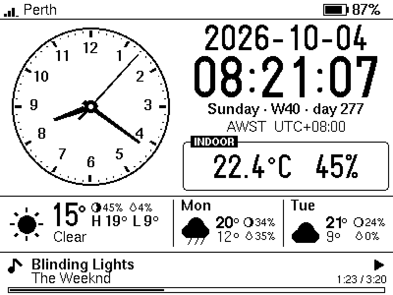

*The pictures in this README are renders of the real drawing code (see [Developer tools](#developer-tools)), not photos.*

| | |
| --- | --- |
| **Date and time** | Date (ISO `2026-10-04` unless you choose another of six formats), time with seconds (24 h, or a 12 h clock with AM / PM), weekday, ISO week number, day of year, zone name and UTC offset |
| **Analog clock** | Hour, minute and second hands; the second hand ticks exactly on the second (or sweeps, see `CLOCK_SWEEP_FPS`) |
| **Weather** | Now, today's high/low, and the next two days (Open-Meteo, no API key), each with the **chance of rain** (a drop) and the **moon** (how much of it is lit). Sunrise, sunset, UV and wind when nothing is playing |
| **Indoor** | Temperature and humidity from the on-board SHTC3, corrected for board self-heating |
| **Battery** | Gauge and percentage, with a bolt in it while charging and a tick when full; **blinks below 20 %** (not while charging); an **estimate of the runtime left** on the Info page; a **gentle shutdown** before the cell is flat; if you ask for it, a **log of its own power readings** for comparing settings |
| **Spotify** | What is playing, progress, device and volume; the **KEY button** is the remote: 1 click play/pause, 2 clicks next, 3 clicks previous |
| **Settings** | Units, time and date format, WiFi (and WiFi *off*), location, time zone, Spotify, battery and power options from a **file on an SD card**, read once at boot and kept in the clock's flash, so the card can come out again |
| **Updates** | A new build can go in **from the SD card** (no cable, no WiFi needed): copy the exported `.ino.bin`, restart. It is checked first, installed into the second app slot, and kept only if it runs for a minute, else the old one returns |
| **Also** | WiFi strength, a legend page that explains every symbol and button, system and power info pages, hardware RTC so the right time shows before WiFi is up |

> **Status.** The first version of this sketch (clock, weather, indoor sensor, battery gauge, display) has run on the
> real board, and so have the 80 MHz setting and the frame timing described under [Power](#power) (measured by the
> board's owner). Of what came with 1.3 and after, the owner has since seen three things work there: **a settings
> file read from an SD card, a firmware installed from the card, and the processor slowed to 20 MHz** between syncs.
> The rest, **the shutdown, how good the runtime estimate is, the clock drift measurement, the moon, the backup
> network, most of [Saving power](#saving-power), the power log, the light sleep, the display's low power mode**, as well as the Spotify linking flow, the charging indicator and the
> frame scheduler from earlier, has so far only been checked on a PC (renderer, fuzz test, simulations, tens of
> thousands of host-side checks) and compiled for the board. [Not yet tried on the board](#not-yet-tried-on-the-board)
> goes through it item by item, and [Troubleshooting](#troubleshooting) says what to look at if a first guess is off.

## Quick start

1. **Arduino IDE settings** (as the repo's [Tools-Configuration.png](../../../Tools-Configuration.png), with two changes
   that save power): ESP32S3 Dev Module, USB CDC On Boot *Enabled*, Flash Mode QIO 80 MHz, Flash Size 16 MB, Partition
   Scheme *16M Flash (3MB APP/9.9MB FATFS)*, **PSRAM *Disabled***, **CPU Frequency *80MHz (WiFi)***. Core: esp32 by
   Espressif **3.x** (built with 3.3.8). The clock needs neither the PSRAM nor the speed; together they cut the current
   to a third, see [Power](#power). (The sketch also sets 80 MHz itself, and the *Power and settings* page warns if the
   PSRAM is switched on.) The sketch is about 1.5 MB (just under half of the 3 MB app partition), so the default 1.2 MB
   partition scheme is too small. The 9.9 MB FAT part of this scheme is where the clock keeps its
   [power log](#the-clocks-own-log), if you switch that on; otherwise it is not touched.
2. **Libraries:** [U8g2](https://github.com/olikraus/u8g2) (a copy is in `01_Arduino_Libraries/U8g2`; copy it into your
   Arduino `libraries` folder or install it from the Library Manager) and **ArduinoJson 7.x** (Library Manager).
   WiFi, HTTPClient, WebServer, ESPmDNS, Preferences, Wire and the SD card driver come with the ESP32 core.
3. **WiFi and place:** either copy `secrets.example.h` to `secrets.h` and enter your WiFi name and password (2.4 GHz
   only; `secrets.h` is git-ignored; it can also hold a second network, your place, your battery and any other setting
   the card can set, see [Building the settings in](#building-the-settings-in)), **or** leave them out and put them in
   a settings file on an SD card after the first start, see [Settings from an SD card](#settings-from-an-sd-card).
   `secrets.h` is optional: without it the sketch compiles all the same and the clock starts with no network until the
   card says otherwise.
4. Upload. Open the Serial Monitor at 115200 baud for a log (type `help`). From then on a new build can also go in
   through the SD card, see [Updating the firmware from the SD card](#updating-the-firmware-from-the-sd-card).

Or from a terminal:

```bash
arduino-cli compile --fqbn esp32:esp32:esp32s3:CDCOnBoot=cdc,FlashSize=16M,PartitionScheme=app3M_fat9M_16MB,PSRAM=disabled,FlashMode=qio,CPUFreq=80 \
  --library ../../../01_Arduino_Libraries/U8g2 .
```

On the first start the status bar tells you what it is doing: *Connecting to WiFi*, *Syncing time*, *Updating weather*.
Until it knows where it is, the status bar says **Earth**. After that the clock keeps itself right: NTP re-syncs
hourly, weather refreshes every 15 minutes (`weather_interval_min`), and the time zone is saved so the correct local time
appears at power-up even before WiFi.

## Settings

Every setting has a built-in default in `config.h`, and `secrets.h` can replace any of them (see
[Building the settings in](#building-the-settings-in)). The clock also keeps settings in its own flash, and reads a
settings file from an SD card. Later wins:

> built-in default  <  saved in flash  <  the file on the SD card

### Settings from an SD card

1. **Format a card as FAT32** (the usual format of cards up to 32 GB; larger cards come as exFAT, which the clock cannot
   read). The card also needs the classic kind of **partition table (MBR)**, which is what cards are sold with: a
   FAT32 volume on a card with a GUID partition table (GPT) shows as FAT32 in Windows and still cannot be read. The
   clock looks at a card it cannot use and says which it is (*SD card is exFAT: format it as FAT32*, *SD card: GPT
   partitions, needs MBR*); see [Troubleshooting](#troubleshooting) for how to put it right. Any small card will do.
2. Put the card in the slot and **restart** the clock: **hold KEY for five seconds and let go**, or turn it off and on
   again (the card is only looked at while it starts). When it finds a card without a settings file it **writes one**, `ESP32-S3-RLCD-Config.txt`, which explains every
   setting and has them all commented out, showing the value in use. A banner says *Wrote settings file to SD card*.
   (A copy of that file is in this repository: [`docs/ESP32-S3-RLCD-Config.example.txt`](docs/ESP32-S3-RLCD-Config.example.txt).)
3. Take the card to a computer, open the file in any text editor, remove the `#` in front of a setting, change its value,
   save.
4. Put the card back and restart. A banner says what happened (*SD settings: 4 changed*), the *Power and settings* page
   lists it and names any line it did not understand. **The settings are now kept in the clock's flash** and the card
   can be taken out. (It is only read at start-up, never while the clock runs, and a card that stays in costs a little
   power.) With the card left in, every later start reads the file again and says *SD settings: 4 in force, none
   new*: nothing was changed because all of it applies already.

The file is forgiving about how it is typed:

* One `name = value` per line. Spaces around the `=` do not matter, and `name: value` works too.
* Values can be in quotes or not: `"My Network"` and `My Network` are the same, with straight or curly quotes. Use quotes
  if a value contains a `#` or starts or ends with a space (`wifi_password = "p#ss "`); a bare `# comment` after a
  value is ignored.
* Names ignore capitals, spaces, `-` and `_` (`wifi_ssid`, `WiFi SSID` and `Wi-Fi-SSID` are one setting), and there are
  aliases such as `ssid`, `password`, `lat`, `lon`, `tz`.
* Numbers may use a comma for the decimal point and carry a unit (`3,4 V`, `80 MHz`, `31.95 S`, `115.86 E`).
* Lines that start with `#`, `;` or `//` are comments. Windows line ends, and files saved as UTF-8 with a BOM or as
  UTF-16, are fine.
* A setting that is not in the file keeps its value. **A line with nothing after the `=`** (`timezone =`) makes the clock
  forget that saved setting and go back to the built-in default; `reset_all = yes` forgets all of them first.
* Something it does not understand is skipped and reported, never fatal. A wrong value leaves the old one in place.

The last column is the name the same setting has in `config.h` / `secrets.h`, see [Building the settings in](#building-the-settings-in).

| Setting | What it does (default) | Built in as |
| --- | --- | --- |
| `wifi` | `on` / `off`. Off switches the radio off: no network time, weather or Spotify, and less power drawn (`on`) | `WIFI_ENABLED` |
| `wifi_ssid`, `wifi_password` | The network (2.4 GHz). Passwords are plain text in the file and in the clock's flash. An open network: `wifi_password = ""` | `WIFI_SSID`, `WIFI_PASSWORD` |
| `wifi_backup_ssid`, `wifi_backup_password` | A second network, used when the first cannot be joined (a phone's hotspot, another router); see [A backup network](#a-backup-network). Empty: no backup | `WIFI_SSID_BACKUP`, `WIFI_PASSWORD_BACKUP` |
| `hostname` | The clock's name on the network, for the Spotify setup page `http://rlcd-clock.local` (`rlcd-clock`) | `APP_HOSTNAME` |
| `ntp_server` | A time server to try first (empty: `pool.ntp.org`, `time.cloudflare.com`, `time.google.com`) | `NTP_SERVER` |
| `wifi_power_save` | `normal` / `max`: how long the radio sleeps between messages. `max` saves a little more but can delay every reply, the network time included, by up to a third of a second (`normal`) | `WIFI_POWER_SAVE` |
| `wifi_mode` | `always` or `sync`. Sync switches the radio off between syncs, which draws far less on a battery; see [Saving power](#saving-power). **Not yet tried on the board** (`always`) | `WIFI_MODE` |
| `units` | `metric` (°C, km/h) or `imperial` (°F, mph) (`metric`) | `USE_FAHRENHEIT` (`1` = imperial) |
| `time_format` | `24h` or `12h` with AM / PM (`24h`) | `TIME_FORMAT` |
| `date_format` | `iso` 2026-10-04, `dmy` 04/10/2026, `mdy` 10/04/2026, `dmy-dot` 04.10.2026, `d-mon-y` 4 Oct 2026, `mon-d-y` Oct 4, 2026 (`iso`) | `DATE_FORMAT` |
| `show_week` | The ISO week number and the day of the year after the weekday (`on`) | `SHOW_WEEK` |
| `latitude`, `longitude` | Exact coordinates; they win over `location` | `LOCATION_LATITUDE`, `LOCATION_LONGITUDE` |
| `location_label` | What the status bar shows (empty: the name that was found) | `LOCATION_LABEL` |
| `location` | A place to look up (Open-Meteo), such as `Perth` or `"Paris, France"` | `LOCATION_QUERY` |
| `timezone` | An IANA name (`Australia/Perth`, not case sensitive) or a POSIX rule (`AWST-8`); empty: follow the location. **With WiFi off nothing can look it up: set it here** | `TIMEZONE_POSIX_OVERRIDE` |
| `spotify`, `spotify_client_id` | Spotify on / off, and the Client ID of your own app (see [Spotify](#spotify)) | `SPOTIFY_ENABLED`, `SPOTIFY_CLIENT_ID` |
| `spotify_live` | Only matters with `wifi_mode = sync`. `on`: the radio stays on while music plays and the strip follows your phone within seconds. `off`: the radio sleeps while music plays too and the clock looks again when the track should be over; see [Music in sync mode](#music-in-sync-mode). **Not yet tried on the board** (`on`) | `SPOTIFY_LIVE` (`1` / `0`) |
| `indoor_offset` | °C added to the indoor temperature, to make up for the board's own heat (`-4.0`) | `INDOOR_TEMP_OFFSET_C` |
| `battery` | `auto` or `none`. Say `none` when no battery is fitted: the gauge shows `USB` and nothing is estimated or shut down. The clock cannot tell by itself, see [Battery](#battery) (`auto`) | `BATTERY_MODE` |
| `battery_capacity_mah` | The battery's capacity, so the *Power and settings* page can show the average current (`0` = unknown) | `BATTERY_CAPACITY_MAH` |
| `battery_calibration` | A multiplier for the measured battery voltage, the real voltage divided by the one shown: 4.20 V on a tester against 4.133 V shown gives `1.016`. `1` = none. See [Calibrating the voltage](#calibrating-the-voltage) | `BATTERY_CALIBRATION` |
| `low_battery_shutdown`, `battery_cutoff_v` | Switch off before the cell is flat, and at what voltage, 3.10 to 3.60 (`on`, `3.30`) | `LOW_BATTERY_SHUTDOWN`, `BATTERY_CUTOFF_V` |
| `cpu_mhz` | `80`, `160` or `240`; 80 is plenty for a clock (`80`) | `CPU_MHZ` |
| `cpu_idle_mhz` | `off`, `80`, `40` or `20`: the CPU clock while the radio is off (`wifi = off`, or between the syncs of `wifi_mode = sync`); see [The idle clock](#the-idle-clock). **Not yet tried on the board** (`off`) | `CPU_IDLE_MHZ` (`0` = off) |
| `console` | `on`, `auto` or `off`: the USB serial console (the log and the commands). `auto` runs it only while a computer is on the USB port, `off` not at all; shut down, it takes the USB port with it. See [The console](#the-console). **Not yet tried on the board** (`on`) | `CONSOLE_MODE` |
| `power_log` | `on` / `off`. On: the clock writes its power readings into its own flash, one line at each start and every ten minutes, and copies the log to an SD card that is in the slot while it starts; see [The clock's own log](#the-clocks-own-log). The first time, the FAT partition of the flash is formatted. **Not yet tried on the board** (`off`) | `POWER_LOG` (`1` / `0`) |
| `light_sleep` | `on` / `off`. On: between the frames the processor goes into light sleep instead of idling, whenever the radio is off, the console is shut down and no button has been pressed for 8 seconds; KEY and BOOT wake it. Its clock is less exact while it sleeps: keep `wifi_mode = sync` so the network time puts it right. See [Light sleep](#light-sleep). **Not yet tried on the board** (`off`) | `LIGHT_SLEEP` (`1` / `0`) |
| `display_power` | `normal` / `low`. Low: the display's controller refreshes the panel 8 times a second instead of 25.5 (its low power mode), for less current. A frame then shows up 0 to 125 ms after it is sent instead of 0 to 39; the frame timing allows for that, so the seconds change up to about 63 ms early or late instead of 20. How much it saves has not been measured. See [The display's low power mode](#the-displays-low-power-mode). **Not yet tried on the board** (`normal`) | `DISPLAY_POWER` |
| `weather_interval_min` | Minutes between weather updates, 5 to 240 (`15`) | `WEATHER_INTERVAL_MIN` |

(`reset_all`, described above, is not a setting but an instruction.) The accepted spellings of every value are in
the example file the clock writes.

### Building the settings in

Everything the card can set can also be **pre-programmed into the firmware**, so a clock comes out of the box set up
(the way you want the WiFi, the units, the date format, the power saving) with no card at all. Copy
`secrets.example.h` to `secrets.h` (git-ignored, so the passwords stay out of the repository), and `#define` the ones you
want, using the names in the last column of the table above. `config.h` has the factory value of each, with a note.

```c
#define WIFI_SSID "My Network"
#define WIFI_PASSWORD "my password"
#define WIFI_POWER_SAVE "max"        // text values are the words the card file uses
#define TIME_FORMAT "12h"
#define DATE_FORMAT "d-mon-y"
#define SHOW_WEEK 0                  // yes / no values are 1 and 0
#define CPU_MHZ 80
#define BATTERY_CUTOFF_V 3.40f       // numbers are plain
```

* **Same rules as the card.** Text settings and choices are written as on the card (`"12h"`, `"max"`, `"d-mon-y"`; the
  list of choices is in the example file and in `config.h`), yes / no settings as `1` or `0`, numbers as numbers, and
  every value must pass the same checks, such as the 3.10 to 3.60 V of `BATTERY_CUTOFF_V`. A value that does not is
  **left out, not half-used**: the clock keeps the factory value and says so, with a banner at start-up, on the *Info*
  page and in the serial log (`built-in default not used: WIFI_POWER_SAVE: expected normal, max`).
* **The build is the bottom layer**: what an SD card saved in the clock's flash earlier, and the card file, win over it.
  Flashing a new build does not clear that flash. So after changing `secrets.h` a setting that was once on a card
  keeps its old value; put `reset_all = yes` in the file on a card once (or `wifi_power_save =` with nothing after the
  `=` for just that setting) and the build's value counts again.
* Every setting in the table has a macro (a test in `tools/tests` fails if one is ever added without), so the two ways
  of setting up a clock cannot drift apart. The Spotify Client ID, the WiFi passwords and your place are the ones you
  would not want in a public repository: that is what `secrets.h` is for.

### A backup network

Give the clock a second network (`wifi_backup_ssid` and `wifi_backup_password`, or `WIFI_SSID_BACKUP` and
`WIFI_PASSWORD_BACKUP` in `secrets.h`) and it uses that when the first cannot be joined: a phone's hotspot, another
router, the guest network.

* The main network always comes first, at start-up and after a drop. If it is not joined within 20 seconds the clock
  tries the backup, and so on, one after the other, until one of them works.
* While it sits on the backup the clock **looks for the main network every 10 minutes** (a scan of a few seconds, not
  while the Spotify setup page is being served) and goes back to it as soon as it is in range (-80 dBm or better), so it
  does not stay on a phone's hotspot for days. If going back does not work (the main network is in range but will not
  take the clock) the looks come further apart, 20 minutes, 40, then every hour, until the main network is joined again.
  A *hidden* main network cannot be seen by a scan: the clock then stays on the backup until that drops.
* The *Info* page says `(backup)` after the network name when the clock is on the second network.
* "Joined" means the clock has an address on that network. A network that is up but has no internet is not noticed: the
  clock would carry on trying the weather and the time there.
* A backup that has the same name as the main network is ignored. With only a backup set, it is simply the network.

## Updating the firmware from the SD card

A clock on a shelf, perhaps with WiFi off, can be updated without a cable: build the sketch on your computer, copy the
firmware file to the SD card, put the card in and restart the clock.

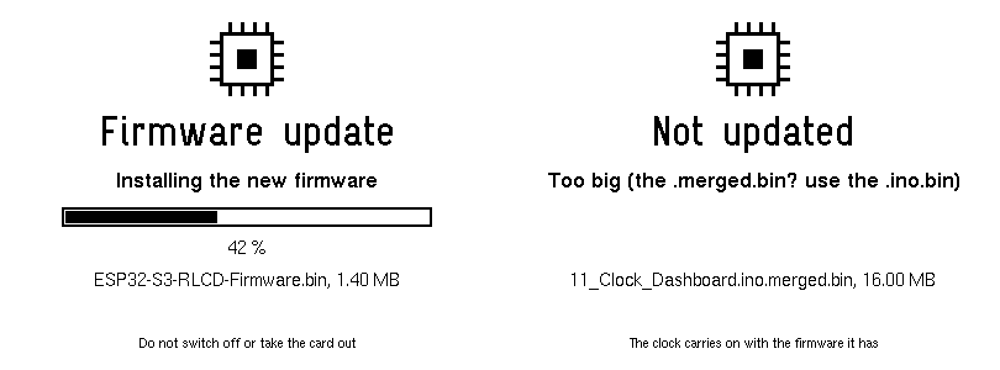

1. In the Arduino IDE choose **Sketch → Export Compiled Binary** (or add `--export-binaries` to `arduino-cli compile`),
   with the same board settings as for a USB upload. The sketch's `build/<board>/` folder then holds several files; the one
   you want is **`11_Clock_Dashboard.ino.bin`**. Not the `….merged.bin`: that is the whole 16 MB flash image for a first
   install with a programmer, and the clock refuses it (*Too big*).
2. Copy it to the top folder of the FAT32 card, as it is or named **`ESP32-S3-RLCD-Firmware.bin`**. With more than one of
   these files on the card the clock does nothing and says so.
3. Put the card in and restart the clock (hold KEY for five seconds and let go). At start-up it checks the file, shows a progress screen, writes the firmware and
   restarts into it; about 15 to 30 seconds (an estimate, not measured). Afterwards the file is renamed `….done`, so it is
   not installed again. A settings file on the same card is applied first, and kept; the banner about it (*SD settings:
   4 changed*) comes after the restart, from the new firmware. (If the firmware that does the installing is 1.4 or
   older, that banner says *SD settings: 4 in force* instead: the settings were applied all the same.)

How it stays safe:

* **The firmware that runs is not touched** until the new one has been written and checked. The whole file is first
  compared with the SHA-256 at its end (a damaged or cut-short copy is refused before anything is written), then it goes
  into the *other* of the two app slots, and the bootloader is switched over only after that image has verified. A card
  taken out half-way, or a power cut, only loses the update.
* **Files it will not use** (the screen says why): the wrong chip (it has to be an ESP32-S3 app image), a bootloader or
  `.merged.bin`, a file too big for the slot, the build that is already running, a build the card installed before (so a card
  left in the clock cannot make it install the same file again and again; `fwforget` on the serial console allows it), and
  anything while the battery is under 3.60 V (plug in USB first).
* **A new firmware is on trial for its first minute.** If the clock resets in that minute (a crash, a hang the watchdog
  catches, or you pulling the plug) the bootloader puts the previous firmware back, and the Info page says so (*the last
  SD card update was rolled back*). After a minute without a reset the new one is kept. The Info page counts the trial
  down; going to sleep on purpose and the `reboot` serial command count as passing it. If the bootloader refuses the
  confirmation (a flash fault) the clock tries again a few times, and until it works the Info page says *NOT confirmed
  yet*, as a reset would still undo the update.
* **Needs two app slots.** The partition scheme from the Quick start has them; a single-app scheme gets the message *No
  second app slot*. The very first install of this feature has to come by USB, as the updater has to be in the firmware.
  A USB upload always works, whatever happened to the slots.
* There is **no signing**: whoever can put a file on the card can change the firmware, as whoever has a USB cable can.

**Which build is running?** The first line of the *System info* page says, for example, `RLCD Clock 1.4, 2026-10-07,
build 3f9a12c`: the [version](#versions), the day it was compiled, and a **build id**. The version only changes when
someone changes it and a day can see many builds; the id changes whenever the program does. It is the start of the
hash by which the updater tells builds apart: the SHA-256 of the `.ino.elf` that is built along with the `.ino.bin`
(`Get-FileHash` in PowerShell, `sha256sum` elsewhere), so you can tell which file a clock runs. The same sources built
in another folder (and so, as a rule, on another computer) get another id: the hash covers the debug information, and
that names the folders.

Serial console: `fw` shows what runs and what is in the other slot (with sixteen digits of each build id), `rollback`
switches to the other slot now (and restarts), `fwforget` clears the memory of the last build installed from the card.

If you leave **WiFi off**, nothing corrects the clock any more: it starts from the hardware RTC and then counts with its
own crystal. A clock crystal is good for a second or two a day, depending on the temperature; the clock **measures its own
error** while it has WiFi (see [Time zone and clock](#time-zone-and-clock)) and puts the figure into the example file.
Turn WiFi on for a few minutes now and then and it sets itself again.

## Controls

| Button | Gesture | Action |
| --- | --- | --- |
| **KEY** (GPIO18) | 1 click | Play / pause |
| | 2 clicks | Next track |
| | 3 clicks | Previous track (like most players, Spotify may restart the current track first if it is well in) |
| | hold 0.8 s | Refresh weather and Spotify now |
| | hold 5 s, then let go | **Restart the clock.** That is when it reads the SD card, so this is how a card you have just put in gets read (settings, a firmware file) without switching the clock off. A banner says when to let go |
| **BOOT** (GPIO0) | click | Next page: Dashboard, Now Playing, System info, Power and settings, Legend |
| | 2 clicks | Back to the dashboard |
| | 3 clicks | System info page |
| | hold 1 s | Invert the screen (remembered) |

Each key action shows a banner at the bottom of the screen straight away; if Spotify refuses (no active device, rate
limited, no Premium) the banner changes to say why. With `wifi_mode = sync` a press of KEY also switches the radio on, and
any button makes a clock that found none of its networks look for them again at once (see [Saving power](#saving-power)).
Holding KEY while the clock starts keeps the serial console on for that run, whatever the `console` setting says. The
**Legend** page shows these and every symbol on the screens, drawn with the same code as the screens themselves:

<p>
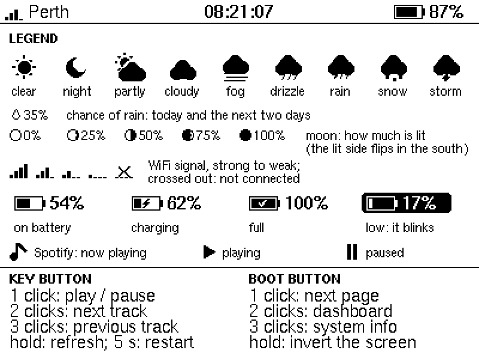
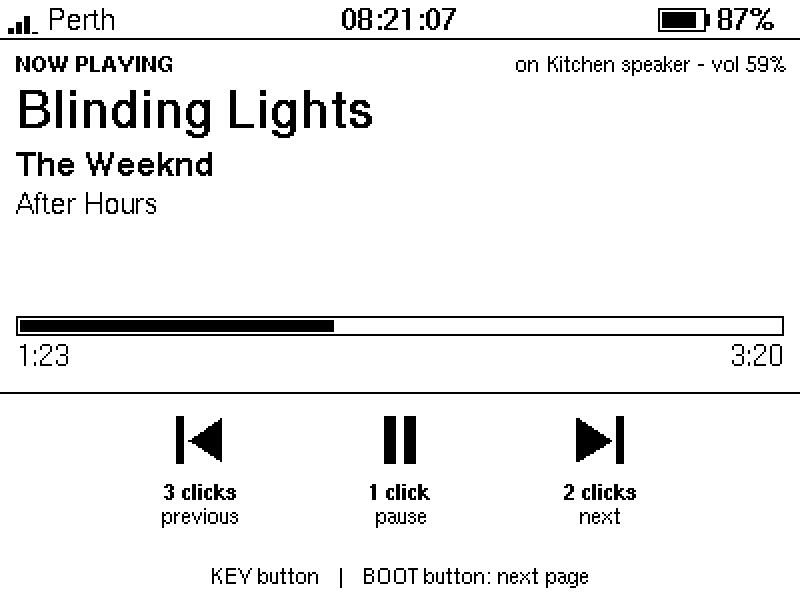
</p>
<p>
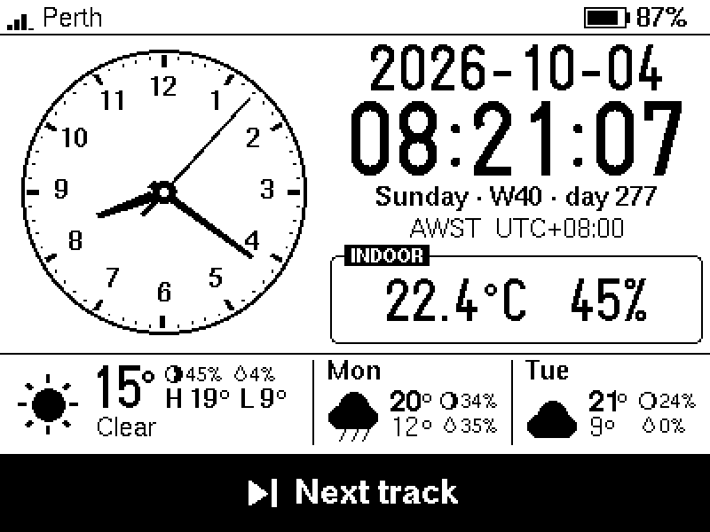
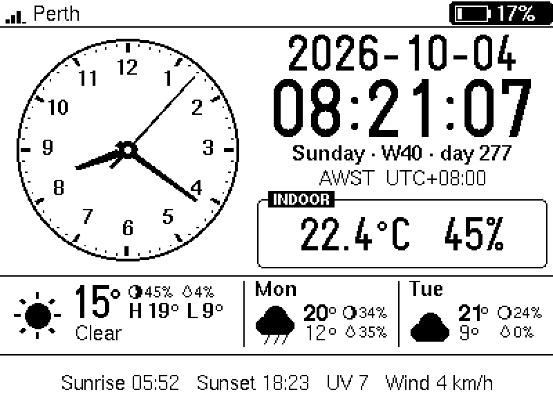
</p>

*The legend page, the Now Playing page, the feedback banner for a key press, and one phase of the low-battery blink (the
gauge alternates between normal and inverted once per second below `BATTERY_LOW_PERCENT`).*

## Weather, rain and the moon

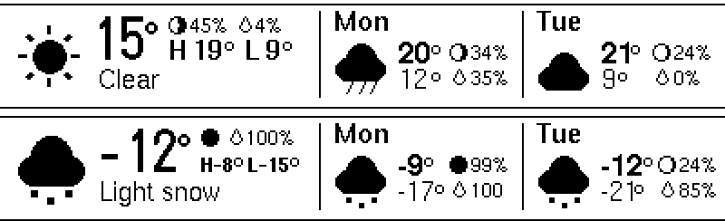

*Today (left) and the next two days. Top row of today: the moon and the chance of rain; below: the high and the low on one
line. The big temperature starts exactly where the condition text ("Clear") does.*

* A drop and a percentage is the **chance of rain** (the day's maximum, from Open-Meteo). The drop is outlined like the
  moon, 7 × 9 pixels, and its bottom row is the bottom row of the digits beside it.
* The **moon** is drawn as a 10 pixel disc, the lit part filled, with the share lit next to it. A growing moon is lit on
  the right when seen from the northern hemisphere and on the left from the southern; the clock mirrors it by the sign of
  your latitude (when it knows it). The three discs are the moon at this time of day today, tomorrow and the day after.
* There is no moon data in the weather service, so it is computed on the clock from the date (`moon.h`: the main terms of
  the standard series for the Sun's and the Moon's longitude). Checked against 24 published new and full moons (the
  eclipses of 2000 to 2025 and every new moon of 2024) and four quarters, the darkest and the brightest moments land
  within half an hour of the almanac, and the share lit is good to a fraction of a percent.
* Wide numbers squeeze the row beside them (-12 °, 104 °F): the moon first loses its percentage, then the moon goes, and
  the high and low shrink their gaps and then their type; nothing ever touches the separators (checked on the rendered
  pixels).

## Spotify

Optional. Without a Client ID the clock simply has no Spotify features. Spotify has no way to ask your phone or PC what
is playing except through its Web API, so the clock needs your permission once.

**You need:** a Spotify **Premium** account. Spotify requires Premium both to *own* a development-mode app and to
*control* playback through the API. A free account cannot be used for either. (Rules checked against Spotify's
documentation in October 2026; they have been changing, see the links at the end.)

**Set up**

1. Open the [Spotify developer dashboard](https://developer.spotify.com/dashboard), *Create app*. Any name; tick *Web API*.
   Under **Redirect URIs** add exactly `http://127.0.0.1:8888/callback` and save (Spotify does not accept `localhost`).
2. In the app's *Settings > User Management* make sure your own Spotify account is listed (development-mode apps work
   for up to 5 allow-listed users).
3. Copy the app's **Client ID** into `secrets.h` as `SPOTIFY_CLIENT_ID`, or into the SD card settings as
   `spotify_client_id`. No client secret is used or stored.
4. Restart. The bottom strip of the dashboard now says *Spotify: open http://192.168.x.x to link*. Open that address (or
   `http://rlcd-clock.local`) in a browser on the same network. The page offers two ways to finish:
   * **A. The helper (easiest; needs Python 3 on the computer you are browsing from).** Download `spotify_link.py`
     from the page (the clock serves it) and run `python spotify_link.py 192.168.x.x`. It opens Spotify; press *Agree*
     and the clock is linked. Nothing is installed and the script exits when it is done.
   * **B. By hand, any browser.** Follow the page's *Open Spotify* link and approve. The browser then lands on a
     "can't reach this page" error for `127.0.0.1`; that is expected. Copy the **whole address** from the address bar
     (`http://127.0.0.1:8888/callback?code=...`) and paste it into the box on the clock's page.
5. Play something on any device. It appears on the clock within about 10 seconds. If a device has been idle for a while
   Spotify forgets it; press KEY once and the clock asks Spotify to resume on the last device it saw.

**Why 127.0.0.1 and a helper?** Spotify refuses a plain-http redirect as *insecure*, with one exception: `127.0.0.1`,
which means "this computer". So Spotify's answer is always sent to the computer you approve on, and something there has
to pass it to the clock: the helper does (it listens on `127.0.0.1:8888` while you approve, up to five minutes, and
forwards the redirect to the clock's `/callback`), or you do, by pasting the address. An `https://` redirect straight to
the clock is possible in principle, but the clock would have to serve TLS with a self-signed certificate (so the browser
warns every time) and its address would have to be registered in the Spotify dashboard (so it needs a fixed IP); that was
not done. A small hosted redirect page would be another way, at the price of depending on a web host.

**Good to know**

* The link page is only served while no account is linked (and during the last 14 days before the link expires). The
  little web server handles one connection at a time, so if the page takes a few seconds to appear the first time
  (browsers sometimes open a spare connection), just wait or reload. While it is being served the radio's longer sleep
  (`wifi_power_save = max`) is switched off so the page answers promptly.
* Only the *read playback state* and *modify playback state* permissions are requested.
* The refresh token is kept in the chip's flash (NVS), unencrypted, like any other WiFi-connected hobby device.
  `unlink` in the serial console forgets it.
* **Spotify expires the link after 6 months** whatever you do. The Info page shows the days left; when 14 remain the
  link page comes back so you can renew in a minute. If it lapses the clock goes back to *please link again*.
* Spotify gives development-mode apps a small request quota and has locked out polling that was too eager. The clock
  polls every 10 s while playing (15 s paused, 30 s idle), extrapolates the progress bar in between, and obeys a `429`
  `Retry-After` even across reboots (the dashboard says how long). A KEY press first looks at what the player is
  really doing, so pressing it right after starting music on your phone pauses it instead of sending a useless "play".
* Titles in scripts the built-in fonts do not cover (CJK, Cyrillic, ...) show `?` for those letters; typographic quotes
  and dashes are mapped to ASCII.

## Time zone and clock

* `location` -> Open-Meteo returns the IANA zone (`Australia/Perth`) -> `tz_table.cpp` (597 zones from the tz database)
  maps it to a POSIX rule (`AWST-8`) -> `tzset()`. Daylight saving then happens on the device with no more lookups,
  and the rule is saved to flash. A zone name newer than the table falls back to a fixed UTC offset that is refreshed
  with every weather update. The `timezone` setting pins a zone by hand (an IANA name, or a POSIX rule).
* The PCF85063 RTC holds UTC. At boot it provides the time immediately; each NTP sync (hourly) updates it. HTTPS needs a
  believable clock, so network requests wait for NTP or a valid RTC. With WiFi off the RTC is the only source, and a
  board whose RTC was never set stays at `--:--:--` until WiFi has been on once.
* Digits that change every second, minute or day are laid out in fixed cells (`ui.cpp`), so the time does not shift
  sideways as it counts: U8g2 measures a string by its ink, and centring on that moved the clock by up to 5 px
  depending on which digits it held. The host renderer checks this on thousands of frames (the 24 h clock, the 12 h
  clock with its colon, the date, the status-bar clock), each with a deliberate failure to make sure the check can see it.
* **How far off is the clock's crystal?** Each NTP sync corrects the system clock by the amount it had drifted since the
  last. `drift.h` keeps the corrections, fits a line through them (one point per half hour, up to two days) and shows the
  result on the *Power and settings* page as parts per million and seconds a day, once it has three hours of syncs. It is
  also kept in flash for the note in the example settings file. In simulation, with 30 ms of network jitter, a day of
  hourly syncs measures a drift to within one ppm (a ppm is 0.09 s a day).

### Date and time formats

`time_format = 12h` shows `9:45` large with the seconds and AM / PM small beside it; a one-digit hour leaves its cell
empty rather than moving everything. Dates in the text formats (`4 Oct 2026`, `Oct 4, 2026`) use English month names.
All six formats fit the date line in every month (checked on the rendered pixels).

<p>
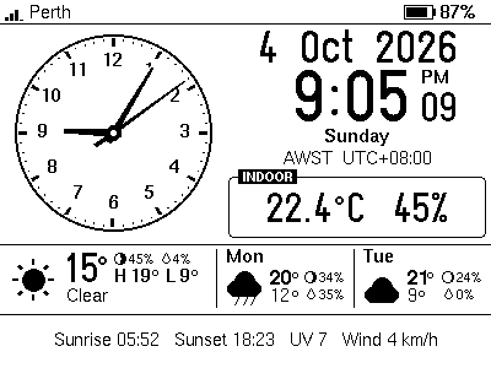
</p>

### Keeping the seconds on time

The panel refreshes itself 25.5 times a second, so a frame shows up 0 to 39 ms after it has been sent (8 times and 0 to
125 ms with `display_power = low`, see [The display's low power mode](#the-displays-low-power-mode)). The clock therefore
draws the coming second into the display buffer ahead of time (with at least 60 ms to spare, more if drawing has been
slow lately) and sends it just before the second starts, timed so the average error is zero (`DISPLAY_LATENCY_MS`).
A slow draw cannot make the digits late any more, only the short transfer is exposed. `frame_plan.h` holds the
schedule; in a simulation of the UI loop (not on the board) with one draw in ten taking four times as long, 148 of 1568
frames went out more than 50 ms late with the earlier draw-just-in-time loop and none with this one, and with random
20-300 ms stalls (a flash write, WiFi activity) the count fell from 234 to 50 of 3525. A stall of more than about
150 ms still shows: nothing in software can hide a frozen CPU. **On the board, at 80 MHz, after a while: 1154 frames sent,
0 late, worst 2 ms** (the *Frames* line of the Info page).

Two things are also kept away from the moment of the tick: slow work (the sensor reads) only runs when more than 300 ms
are left, and flash writes (saving a time zone or a Spotify token; the flash is only touched when the value changed)
wait for the middle of a second, because a flash write stops both cores for a while. The WiFi status calls are made
before the shared-state lock is taken, so a slow WiFi driver cannot hold the UI up.

**If the seconds still stutter now and then,** the Info page says where to look:

| Info page line | Meaning |
| --- | --- |
| `Frames   11520 sent, 2 late, worst 61 ms` | Frames that went out more than 30 ms behind plan, and the worst. Anything here means the firmware itself stalled (the serial log prints every frame more than 100 ms late; `timing` shows the draw and send times) |
| `Time     NTP synced 12 min ago, last step -38 ms` | The size of the last correction NTP made to the clock. Steps of 100 ms or more mean the network's latency is uneven (satellite and mobile links can do that) and the displayed seconds were that far off for a while |

Both quiet while you still see a stutter: the delay is in the panel itself.

## Indoor temperature

The SHTC3 sits beside the ESP32 and the battery charger, so it reads warm. `indoor_offset` defaults to **-4.0 °C**,
the value Waveshare's own driver subtracts; calibrate it against a thermometer you trust and put the sensor reading from
the Info page next to it. Humidity is corrected to match (relative humidity rises as air cools), which Waveshare's
driver does not do.

## Battery

Reads the divider on GPIO4 (x3), averages 16 ADC samples, smooths the result, and maps the voltage to a charge level
with a discharge curve measured in this clock: a 3400 mAh 18650 run from a full charge until the clock shut itself down
at 3.30 V, 81 hours at a steady load, each point being the share of that run still to go when the cell got there
(`calc.h`; the readings are in `tools/tests/fixtures/rundown-2026-10.csv`). Half charge is 3.78 V, 20 % is 3.58 V, and
below 3.46 V only 5 % is left. (The generic curve before it, from 1.0 to 1.9, put 3.70 V at 12 % where that cell still
had 39 %, so a clock recharged at its "20 %" was really about half full.) A cell of another make or chemistry can sit a
little higher or lower. The gauge blinks below `BATTERY_LOW_PERCENT` (20) and stops
once it has recovered to 23 so it cannot flicker around the threshold; it does not blink while the battery is being
charged.

### Calibrating the voltage

The ADC and the divider can read a few percent low, and then a cell that is full (4.20 V on a LiPo tester) shows as
about 4.13 V: the gauge stops at 93 %, and the clock, which calls a cell full from 4.16 V, never says so. A single
multiplier, `battery_calibration`, fixes it, and everything else (the gauge, the estimate, the shutdown, the charge
detection) then works with the corrected voltage. The *Power and settings* page shows the factor next to the voltage once
it is not 1.

1. Read the voltage the clock shows on the *Power and settings* page (*Battery 4.133 V*), and measure the same battery at the
   same time with a tester or meter (4.20 V).
2. The factor is the real voltage divided by the shown one: 4.20 / 4.133 = **1.016**. Give it to the clock in any of
   three ways:
   * the settings file on the SD card: `battery_calibration = 1.016`;
   * the serial console: **`batcal 4.20`**. The clock measures for two seconds (the median of 25 readings, so WiFi bursts
     do not skew it), works the factor out, saves it to flash and restarts; `batcal` alone shows the raw and the
     corrected voltage, `batcal reset` goes back to no correction. Leave the clock alone while it measures;
   * `BATTERY_CALIBRATION` in `secrets.h` (the build's default; the settings file and the console win over it).
3. Allowed are factors from 0.80 to 1.25; `batcal` refuses a figure that is further off than that, as it means a wiring
   problem or a typo, not the ADC. The best moment to calibrate is a cell the charger has finished with (4.20 V): the
   voltage then holds still while you read both, and a multiplier's error is largest at the top. The result is only as
   good as the tester you hold. A clock that reads a little over 4.20 V on the charger afterwards (4.22 V, say) is not
   proof of a wrong factor: chargers hold 4.20 V to within about a percent either way. Only the tester can tell the
   two apart.

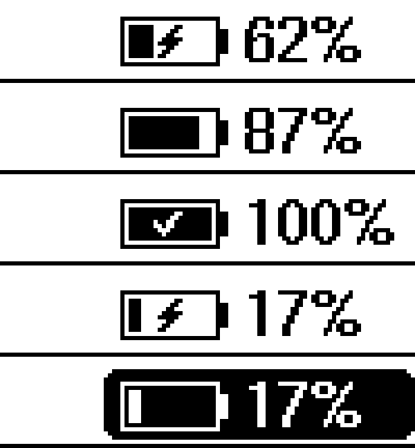

*The gauge, top to bottom: charging (a bolt in a window in the fill), running on the battery (nothing added), full (a tick
cut out of the solid fill), 17 % while charging (no blink), 17 % on the battery (blink phase). The gauge itself never
moves when the state changes.*

**No battery fitted?** The clock cannot tell. On USB the empty battery connector reads about 4.2 V, like a full cell, so
a clock running from USB alone shows a full battery. Say `battery = none` in the settings and the gauge shows `USB`
instead, with no bolt or tick, no estimate and no shutdown.

**How it knows what the battery is doing.** The board has no charge-status signal (the charger's STAT output only lights
an LED), so `charge.h` works it out from how the battery voltage moves:

* plugging USB in makes the charger push current through the cell, so the voltage steps up by tens of millivolts at
  once; unplugging steps it down. A step of 40 mV or more that stays is spotted about a minute after the cable moves;
* while charging the voltage climbs 1.5 mV per minute or more; on the battery it falls (steeply near full, slowly in the
  flat middle of the curve); a charger that has finished holds it flat near 4.2 V, which is shown as full;
* **flat at the top is only called *full* when the clock saw the charge that led there**, or when the cell has not
  fallen for some three hours. A clock that is started on its battery with a nearly full cell looks every bit as flat
  for twelve minutes (the radio mostly off, the top of the curve falls by 0.03 to 0.1 mV a minute), and up to 1.4 that
  was called *full* eleven minutes after every such start, and stayed so for hours (found on the board, at 99 %). With
  no sign of a charger the clock now shows no icon and takes itself to be on its battery (the *System info* page says
  *on battery?*, and *discharging* once it has seen the voltage fall, which under a light load may be never);
* that trend is judged over the last 12 minutes (8 before it is trusted). Readings are reduced to the upper end of each
  15 s so WiFi transmit dips do not count, and a change in load, which moves the voltage for good and fools a plain
  straight-line fit, has to be confirmed by a second fit that allows one level shift;
* the first three minutes after boot are not used at all: the board draws more while it joins WiFi and fetches over
  TLS, the battery sags under it and recovers, and in the simulations that recovery was taken for a plug-in on almost
  every boot once the sag reached 60 mV;
* **a slow history, for ending *full*.** Unplugging a full battery gives no step, and with a light load (the clock with
  its radio mostly off draws 10 to 45 mA from a 2500 mAh cell) the top of the curve falls by only 0.07 to 0.3 mV a minute,
  which twelve minutes cannot tell from flat: the first version sat on *full* for hours. So one level per five minutes is
  also kept, for four hours: a charger holding the cell keeps it within a few millivolts of its plateau, a load takes it
  down for good, and **a level 13 mV below the plateau ends *full***. Once *full* has ended for any reason, flat does not
  bring it back until the last hour has not come down by more than 1.2 mV (a recharge, or a cell that sits still), and
  then only by one of the two ways above: a charge that is seen, or three hours without a fall.

It is a heuristic and shows no icon rather than guess. Timings against simulated traces (noise, WiFi dips, level
shifts; 300 random sequences each), not against the board:

| What happens | Icon changes after |
| --- | --- |
| USB plugged in or pulled out with a step of 45 mV or more | about 1 minute (not in the first ~5 minutes after boot) |
| ... with a small step | 5 to 10 minutes |
| After a restart on a charger that is charging | the bolt after about 13 minutes, sometimes up to 20 (the Info page says *starting up*, then *learning*) |
| After a restart on a charger that has finished | the tick after about three hours, four if the cell was still settling; until then no icon |
| After a restart on the battery | no icon, which is right; the runtime estimate starts at once |
| A full battery unplugged (no step, the voltage just starts to fall), a 1 to 2.5 mV/min fall | 7 to 15 minutes |
| ... a 0.5 mV/min fall (about 150 mA) | 30 minutes |
| ... a light load, a 0.3 mV/min fall (about 45 mA) | about 50 minutes, 30 with the 7 mV step an unplug usually has |
| ... a lighter load, 0.12 mV/min (about 20 mA), or 0.07 mV/min (about 10 mA) | about 2 hours, or 3 hours (an hour or so with the step) |

What it cannot do: charging slower than about 0.1C (under roughly 1.5 mV/min) is not recognised; a charger that lets the
cell sag after it has finished looks like discharging, which for the cell it is; a sudden jump in load of 15 mV or
more is mistaken for a few minutes of charging about once in 60 jumps; and a *full* that has ended comes back without
a new charge only once the cell has stopped coming down: about an hour after a brief dip (a knock on the cable that
takes the voltage down by 13 mV), some three hours after a drop that stays, and not at all in the first three hours
after a start, when there is no history yet to judge by.

**What that means for the runtime estimate.** The estimate runs **whenever no charger shows**: the icon says neither
charging nor full. (Up to 1.4 it waited for the clock to be *seen* discharging, which a light load never is: after a
restart on the battery the **Left** line said *full* or *waiting* for hours, or for good.) While the icon says *full* the
**Left** line says *full* and nothing is worked out, so a clock that is unplugged from a charger that had finished
starts its estimate only when *full* ends: one to three hours under a light load (the table). **To start measuring at
once, restart the clock after unplugging it** (hold KEY for five seconds): a clock that has seen nothing of a charger
takes itself to be on its battery, and the first figure comes 50 minutes later. If it is on a charger after all, the
line says *no drain to measure (on a charger?)* until the tick appears.

The serial console command `battery` prints the voltage, the trend in mV/min, the last step and how much data the
detector has, and the same line is logged once a minute; if the icon ever disagrees with reality those are the numbers
to look at. The thresholds are named constants at the top of `charge.h`.

**For a certain answer** solder a wire from the charger's STAT output (the net that lights the charge LED; check with a
meter that it goes low while charging) to a free GPIO and set `PIN_CHARGE_STATUS` in `config.h`. Low then means
charging; the voltage still decides between full and discharging. This is untested on real hardware.

### How long will it last?

The *System info* page has a **Left** line, and the *Power and settings* page the detail:

<p>
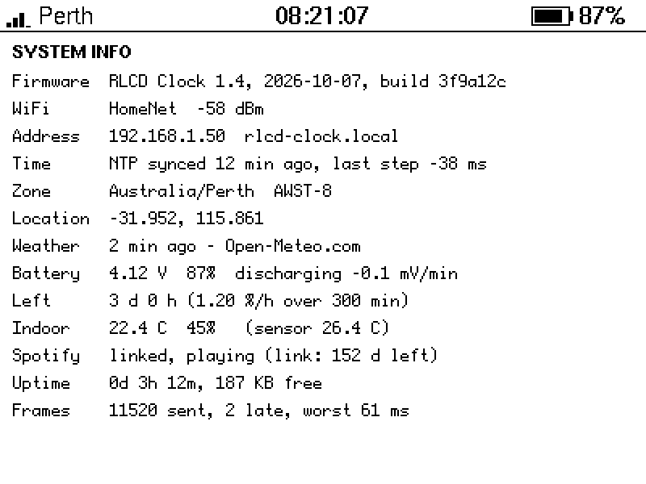
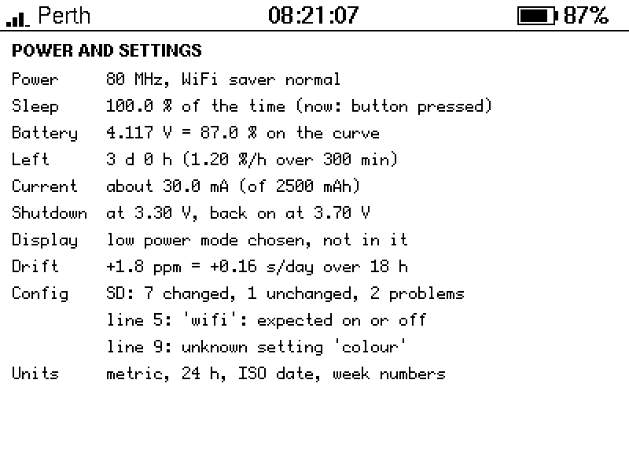
</p>

```
Battery   4.12 V  87%  discharging -0.1 mV/min
Left      3 d 0 h (1.20 %/h over 300 min)
Current   about 30.0 mA (of 2500 mAh)          <- when battery_capacity_mah is set
```

* The voltage is turned into a percentage through the discharge curve *first*. The same drain in mA is a very different
  number of millivolts per minute depending on where on the curve the cell is (5 to 6 mV per percent near the top, 13
  just over 4 V, 5 to 9 in the middle, 37 in the last 5 %), so a trend in volts means little; a trend in percent is one
  steady rate all the way down.
* It is worked out whenever no charger shows (the gauge has neither the bolt nor the tick), which after a start on the
  battery is from the first minute: see *What that means for the runtime estimate* above for the one case that takes
  longer, a clock unplugged from a charger that had finished.
* Above 4.20 V the gauge says 100 % and stays there, but the estimate goes on with the same 5.2 mV to the percent: a
  cell just off the charger reads a little over 4.20 V (4.21 to 4.22 V on the board this was written on), and its
  coming down from there is drain like any other.
* Readings are boiled down to one point per five minutes (their median, so the dips of WiFi transmissions vanish), the
  first 15 minutes after the clock went onto the battery are ignored (a cell just off the charger is still settling),
  and the first figure appears after 30 minutes of settled readings (the page says *learning: first figure in N min*):
  50 minutes after a start in all.
* The rate is a straight line through the points of the last **2 to 8 hours: long enough for the cell to lose about 20 %
  in it**, so a fast drain (a small cell, Spotify playing) is judged over about two hours and a slow one over most of a
  day. Longer is better because a few millivolts are a percent or more, so a 30 minute window chased noise (it was off
  by 60 % or more one time in ten in simulation). The page says how many minutes the figure rests on.
* "Hours left" is the percent above the shutdown voltage divided by that rate: it promises the time at the *average*
  load of the window, the best guess when the load varies. It cannot know what you will do next (turn WiFi off and the
  real answer changes at once; the estimate follows over the next hours).
* **How good is it on the run the curve came from?** Replayed through the estimator (`test_features`), from the third
  hour on 72 of 73 hourly figures were within 15 % of the time the cell really had left, 4 % out on average. In the
  first three hours off the charger the figure is **short** (a quarter to three quarters of the truth): the cell sheds
  what is left of the charge faster than it drains later. The generic curve, replayed the same way, was within 15 % for
  11 of the 73 and up to three times too long.
* **And in general?** `tools/tests/battery_sim.cpp` simulates whole discharges (a cell model with internal resistance,
  ADC noise and WiFi dips; loads of 8 to 90 mA; capacities of 100 to 2500 mAh) and scores the estimate against the true
  time left: in steady drains the typical (median) error was **2 to 8 %** and nine in ten estimates were within **5 to
  20 %**; with a load that changes every couple of hours it was worse, as it must be. That is a model of a cell, not
  your cell: treat the figure as a rough guide, most of all in the first hours off the charger.

### The shutdown

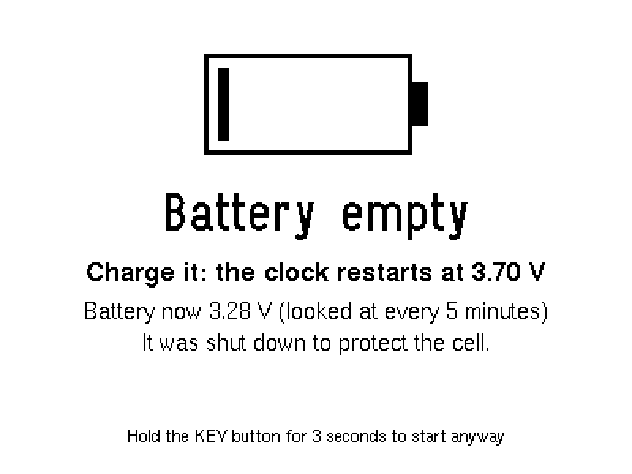

A bare LiPo with no protection board is ruined by being run flat. The board has a protection chip (S-8261) as a last resort,
but it cuts off abruptly and a lot lower, so the **software stops first**:

* when the battery stays under `battery_cutoff_v` (3.30 V, measured while the clock runs) for a minute and the clock is not
  charging, it draws a *Battery empty* screen (which stays on the panel, refreshed only every four seconds: see
  [The display's low power mode](#the-displays-low-power-mode)) and goes into deep sleep;
* every five minutes it wakes for a moment to look at the battery, and it **starts again only above 3.70 V**, which means
  after charging: a cell that has just been relieved of the load springs back by a hundred millivolts or more, so
  restarting at the cut-off would boot, sag, shut down and repeat;
* a press of **KEY** wakes it too (not BOOT: that pin also selects the chip's download mode at reset, so it must not be
  held down as the chip wakes): it shows the screen again for eight seconds, and **holding KEY for 3 seconds there starts
  the clock anyway** (for this run only);
* it also checks the battery first thing at every power-up, before the display or WiFi are switched on;
* `low_battery_shutdown = off` or `battery = none` turns all this off.

Deep sleep is not zero: the 3.3 V converter, the display, the RTC and the other chips on the board draw something (not
measured, probably a few hundred microamps), so a cell left alone for weeks in this state can still reach the protection
chip's cut-off.

## Power

The board's owner measured, on USB at 5 V with no battery:

| Setting | Current |
| --- | --- |
| 240 MHz, PSRAM on (Arduino IDE defaults) | 88 to 111 mA |
| **80 MHz, PSRAM disabled** | **about 30 mA idle, peaks around 70 mA** |

That is why the quick start asks for those two Tools settings, and why the sketch sets 80 MHz in code as well
(`cpu_mhz`; the PSRAM can only be switched off in the IDE, so the *Power and settings* page warns when it is on).
The frame timing survives it: after a while at 80 MHz the *Frames* line read **1154 sent, 0 late, worst 2 ms**. Those
figures are with the Arduino core's own WiFi power saving, which the clock still uses (`wifi_power_save = normal`: the
radio sleeps between beacons). `max` lets it sleep a little longer for a little less power, but nothing was measured and
every reply, the network time included, can then come up to a third of a second late, so it is off by default.

On a battery the same power at 3.7 V is more current than at 5 V, so expect roughly 35 to 45 mA (an estimate, not a
measurement): an 18650 of 2500 mAh lasts about two days, a 1000 mAh pouch about a day. Measured with the power saving
below (`wifi_mode = sync`, `cpu_idle_mhz = 20`, `wifi_power_save = max`, `spotify_live = off`, `console = auto`): a
3400 mAh 18650 ran **81 hours** from a full charge to the shutdown at 3.30 V, about 40 mA on average, which is more than
the 21 mA measured on USB at 5 V with the same settings would make (about 28 mA from the cell); why is not known.
**`wifi = off`** removes the
radio's share (and with it the weather, Spotify and network time); it should lower the current further, but by how much
has not been measured.

Light sleep between the seconds, long left out because the chip keeps time on a less exact clock while it sleeps, is
there since 1.11 as `light_sleep` (off by default): see [Light sleep](#light-sleep). The display's controller has a low
power mode too, there since 1.11 as `display_power`: see [The display's low power mode](#the-displays-low-power-mode).
Not done, so nobody wonders: waking
it every second from the clock chip's own crystal (the PCF85063's interrupt pin is wired to GPIO15, and its countdown
timer could do it), because that timer's registers have not been checked against the chip and the library in the repo
does not drive it.

## Saving power

Six settings go further than `wifi_power_save`: **`wifi_mode = sync`** keeps the radio off between syncs,
**`spotify_live = off`** lets it sleep while music plays as well, **`cpu_idle_mhz`** slows the processor while the radio is
off, **`console = auto`** (or `off`) shuts the USB serial console down, **`light_sleep`** puts the processor to sleep
between the frames, and **`display_power = low`** has the display refreshed 8 times a second instead of 25.5. All six
are **off by default**. The first four have run on the board for days since 7 October 2026, and the owner has measured
the current with them (see [Light sleep](#light-sleep)); `light_sleep` and `display_power` (both 1.11) have not run
on a board yet. Otherwise what follows is what the code does and what a PC simulation of its rules
says, not a measurement. If you have a USB power meter, the figures this section lacks are exactly the ones worth sending back, and
without one the clock's own runtime estimate will do: see [Logging a battery run](#logging-a-battery-run).
[What is switched off](#what-is-switched-off) lists every part of the board and what the clock does about it.

### WiFi sync mode

`wifi_mode = sync` (or `#define WIFI_MODE "sync"` in `secrets.h`) switches the radio off between *sessions*. A session
starts when something needs the network, lasts while there is something to do, and ends 2.5 seconds after the last thing:

| What starts or holds a session | When |
| --- | --- |
| the weather | every `weather_interval_min` (15 minutes) |
| the network time | about every hour: in a session that is going on anyway when it is within 10 minutes of due, on its own when it is 5 minutes late. Drift measurement works as before |
| a look at Spotify (if linked) | once in every session |
| music playing | with `spotify_live = on` (the default) the radio stays on and the clock asks Spotify every 10 seconds, as in always mode; after a pause it stays on 5 minutes more. With `spotify_live = off` it does not: see [Music in sync mode](#music-in-sync-mode) |
| a key press | the radio comes on and stays on for 45 seconds: the toast shows at once, and the action follows as soon as the radio is up (about 3 to 8 seconds on a quiet radio) |
| the *Now Playing* page | on while it is on screen, and for a minute after: this is also how to get to the Spotify linking page (open the page with BOOT and wait for the address to appear) |

**When the network is not there** (the clock went to work with you, the router is restarting) that is not held against
it. The WiFi stack answers "no such network" within a few seconds, the session ends there and then, and the clock **looks
again every 2 minutes for the first ten, and every 5 minutes from then on, for as long as it takes**. A look is one scan
for each network the clock knows: about 5 seconds the first time (it asks twice before it believes that home is gone), 2.5
seconds after that, twice as long with a backup network (worked out from how long the chip takes to scan the channels,
not measured). So a phone's hotspot that is set as the [backup network](#a-backup-network) is found within 5 minutes of
being switched on, with nothing pressed, and **at once when you press a button**: any button makes a clock that found no
network look again (KEY also holds the radio for its 45 seconds). Some phones only announce their hotspot while its
settings page is open, so have that on screen. The status bar says *No known WiFi in range* meanwhile, and the *System
info* page *none in range, looking again in 4 min*.

**When the network is there but the clock cannot get in** (a changed password, a router that refuses it), or it is
joined and nothing gets done, that is a failure: the session gives up after 25 seconds (45 with a backup network) and the
next one waits 1, 2, 5, 10 and then 15 minutes, so a clock that is locked out does not hammer the router. A key press
does not wait for that, and one press buys one attempt. The *System info* page says *cannot join, next try in 9 min*.
The backup network is tried first when it was the one that worked last time.

(None of this applies to `wifi_mode = always`: there the radio keeps looking without a pause for as long as it has no
network, which is the dearest thing it can do. A clock that travels is better off in sync mode.)

**What a PC simulation of those rules gives** (`tools/tests/test_radio.cpp`, a model of the network task with the real
rules):

| Simulated | Radio on | |
| --- | --- | --- |
| A day with a good network | **0.6 %** of the time | 96 sessions of about 6 seconds; 0.9 % with Spotify linked |
| Eight hours away from the network | 0.9 % | 99 looks; 1.7 % with a backup network set (two scans a look) |
| Three hours with a router that refuses the clock | 3.5 % | 15 failed sessions of 25 seconds |
| The router up, the internet down | 2.9 % | the weather and the time retried after 1, 2, 5, 10, 15 minutes |
| Two hours of music, `spotify_live = on` | 100 % | |
| Two hours of music, `spotify_live = off` | 3.5 % | 42 sessions; the next title 5 seconds after the track changes |

The *Power and settings* page shows the real figure (`on 0.8 %, 96 sessions, next in 9 min`) and the *System info* page
says `asleep (sync mode), next in 9 min` while the radio is off. What is not known is the current: how much a session
costs (association, the TLS handshakes) and what the board draws with the radio off.

Things to expect in this mode: the status bar says *Connecting to WiFi...* for a few seconds every quarter of an hour; the
dashboard's Spotify strip is as old as the last session when nothing is playing (a paused track stays until a session
finds it gone); the first KEY press after a quiet time answers a few seconds late; and the radio stack is started and
stopped hundreds of times a day, so watch the *Uptime* line (it shows the free memory) for the first days.

### Music in sync mode

With `spotify_live = on` (the default) music keeps the radio on: once a session's look at Spotify finds something
playing, the clock stays connected and asks every 10 seconds (and just after the track should end), exactly as with
`wifi_mode = always`. The strip is then never more than those seconds behind your phone, and sync mode saves nothing
while the music plays.

`spotify_live = off` (`#define SPOTIFY_LIVE 0`) lets the radio sleep while music plays too. The clock knows how long the
track is and how far in it was, so it counts the progress bar on by itself and **looks again when the track should be
over** (a second and a half after, because Spotify needs a moment to move on): one short session a track instead of a
radio that is on all the time. What that costs:

* Something done **on a phone** shows late. A track you skip stays on the screen until it would have ended; a pause shows
  as a bar that keeps moving until then. The latest it can be is the next weather update, because every session looks
  at the player once.
* Anything done **with the clock** is live as before: a press of KEY brings the radio up, the clock looks first and then
  acts, and the radio stays on for 45 seconds. So is the *Now Playing* page, for as long as it is open and a minute more.
* If the network goes away, the track is taken off the screen at the first look that fails.

### The idle clock

`cpu_idle_mhz = 40` (or `20`; `80` when `cpu_mhz` is higher; `off` for no change; `#define CPU_IDLE_MHZ 40`) lowers the
processor's clock **whenever the radio is off**: with `wifi = off`, or between the sessions of `wifi_mode = sync`. The
clock goes back to `cpu_mhz` **before** the radio is switched on (WiFi works from 80 MHz up) and drops **after** it is off.
It also goes back while a button is down and for 8 seconds after (a frame takes four times as long to draw at 20 MHz as at
80, and whoever pressed wants the answer quickly), and **for as long as a computer is on the USB port and the console
runs**: below 80 MHz the clock of some peripherals follows the CPU and the USB console may stop, which would look like a
crash while you are reading the log. So to see the idle clock at work, take the clock off the computer (a charger or a
power bank is fine, they send no data) or set `console = off`; `power` in the console says what the clock thinks.

| `cpu_idle_mhz` | Drawing a frame | The chip alone, idle, radio off (Espressif) | |
| --- | --- | --- | --- |
| 80 (only below a higher `cpu_mhz`) | about 30 ms | 22.0 mA | the radio can run |
| **40** | about 60 ms | **13.2 mA** | **the one to try first**: the crystal's own frequency, and the lowest clock the datasheet gives figures for |
| 20 | about 120 ms | not published | the lowest the Arduino core lists for this chip |

**Which is the lowest safe one?** 40 MHz is the safe choice and gets most of what there is to get: by the
[ESP32-S3 datasheet](https://documentation.espressif.com/esp32-s3_datasheet_en.pdf) (table 5-9, v2.2: both cores idle,
peripheral clocks off) the chip alone draws 13.2 mA at 40 MHz against 22.0 at 80, 27.6 at 160 and 32.9 at 240. 20 MHz
is the lowest on offer; it should save a few mA more, but Espressif publishes nothing below 40, so that is a guess until
someone measures it. **10 MHz is deliberately not offered**: the software would set it, but a frame would then take a
quarter of a second to draw, so the processor would be busy for a third of every second and there would be little left
to save, and the Arduino core does not list it for this chip.

Two things in the firmware make the low clocks usable. The frame planner is told about every clock change and plans the
first frame at the new clock with the right costs; in the simulation no frame is late at either switch. And **with an
idle clock set the buttons are read by interrupt as well as by the loop**: a frame at 20 MHz takes longer to draw than a
quick tap lasts, so a loop that only looks between frames would lose taps (the test counts them, for taps of 40 to 150 ms
at every moment of the second: 3 in 100 at 40 MHz, 8 in 100 at 20 MHz, none with the changes recorded). Without an idle
clock the buttons are read as they always were.

Things that are not known until someone tries it: the display's SPI clock and the battery ADC were written with 80 MHz
in mind (the Arduino core's own `getApbFrequency()` is known to say 80 MHz at lower clocks on the ESP32-S3,
[arduino-esp32 #7086](https://github.com/espressif/arduino-esp32/issues/7086)), so check that the screen looks right at the
idle clock and that the *Battery* voltage on the *Power and settings* page does not change by more than a few millivolts
when you press a button (which brings the clock up). (The first report from a board: at 20 MHz the pages are drawn and
can be read. The voltage and the frame timing have not been reported yet.)

### The console

The log and the commands run over the chip's own USB port. `console = auto` (`#define CONSOLE_MODE "auto"`) keeps them
**only while a computer is on the port**: ten seconds after the last sign of one, counted from start-up, the console is
shut down, so a clock on a battery or a charger drops it ten seconds after it started and one on your computer keeps it
until the cable is pulled. `console = off` shuts it down at the end of every start-up, computer or not. Shut down means:
nothing is formatted or printed any more, the serial driver is stopped (its interrupt and buffers freed), the USB
transceiver and its pull-up are switched off, and `cpu_idle_mhz` no longer waits for a computer to go away. It **stays
down until the next restart**, because with the transceiver off the clock cannot see a computer arrive, and the computer
no longer sees the clock: there is no serial port, and the Arduino IDE cannot reset it for an upload. Three ways back:

* with `auto`, plug the cable into the computer and restart the clock: hold KEY for five seconds and let go (see
  [Controls](#controls)); no need to switch it off;
* **restart the clock with KEY held down**: the console then stays on for that run whatever the setting says (the
  *Power and settings* page says so). Without switching it off: hold KEY for five seconds, let go, and press KEY again
  while the screen says *Restarting...*, keeping it down for two seconds. From there `set console = on` in the console
  changes the setting for good, and an upload works as usual;
* hold **BOOT** while switching it on (the chip's own download mode, which no setting can take away), or use the
  [SD card](#updating-the-firmware-from-the-sd-card), for the firmware as for the setting (`console = on` in the file).

How much it saves is not measured and will be small next to the radio and the CPU clock (the port is a fixed block of
the chip, not a second processor); the datasheet has no figure for it. It is here so that nothing runs that is not used.
The block's own clock is left on: the SDK's check for a computer on the port keeps reading its registers.

### Light sleep

`light_sleep = on` (`#define LIGHT_SLEEP 1`) puts the processor into **light sleep between the frames**. With the radio
off the clock has little to do in a second: it draws the coming second, sends it just before the tick, reads a sensor
now and then. The rest of the second it used to spend idling awake, in naps of a few milliseconds; now it sleeps until
the next thing is due, and KEY or BOOT wake it at once. The chip keeps its memory and the display its picture. **It is
new in 1.11, off by default and has not run on a board yet.** The Arduino core has no automatic light sleep
(`CONFIG_PM_ENABLE` is not set in core 3.3.8), so the clock asks for each sleep itself (`light_sleep.h`, `power.cpp`).

**When it sleeps.** Only when nothing needs the chip awake:

| Keeps it awake | Why |
| --- | --- |
| the radio, on or about to be | WiFi cannot sleep like this. So with `wifi_mode = always` it never sleeps; with `sync` it sleeps between the sessions, with `wifi = off` all the time |
| the USB console | in light sleep the chip lets go of its USB port, so a computer would lose the clock every second, and one plugged in later would not find it. `console = auto` (the console goes 10 seconds after start-up without a computer) or `off`; a start with KEY held keeps the console, and with it the chip awake |
| a button that is down, pressed in the last 8 seconds, or pressed while the loop was busy and not answered yet | the clock times the clicks, and whoever pressed is waiting for the answer |
| a redraw that is due, the cube, a restart | |
| slow work that is due (the sensors, the battery, a line of the power log) | it runs first; if it has to wait for its part of the second, the sleep ends where that part begins |
| the next frame, a banner to take down | the sleep ends 5 ms before them (and 1/128 of its length more), so the loop finds things as it would have without it |

**What it should save** (an estimate; **nothing of it has been measured**). The owner measured on USB at 5 V, battery
out, with `wifi_mode = sync`, `cpu_idle_mhz = 20`, `wifi_power_save = max` and the console off: **21.1 to 21.4 mA at the
20 MHz idle clock**, about 29 mA at 80 MHz after a button press, 33 to 36 mA with the radio on. The radio is on some 2 %
of the time, so the idle clock is nearly all of the energy. By the
[ESP32-S3 datasheet](https://documentation.espressif.com/esp32-s3_datasheet_en.pdf) (v2.2, table 5-9, the chip alone,
radio off) the chip idles at 13.2 mA at 40 MHz and 22.0 at 80, works at 16.2 and 28.4, and draws **0.24 mA in light
sleep**; Espressif gives nothing below 40 MHz, so 20 MHz is drawn out along the same line (8.8 mA idle). A simulation of
the loop (`tools/tests/test_radio.cpp`: the frames, the slow work, the power log, a press every ten minutes, a radio
session every quarter of an hour; the sleep's way in and out costs 5 ms) gives:

| `cpu_idle_mhz` | Asleep | The chip, without light sleep | with it |
| --- | --- | --- | --- |
| 20 | 76 % of the time | 9.3 mA | 2.8 mA |
| 40 | 85 % | 13.7 mA | 2.6 mA |
| 80 (`off`) | 90 % | 22.3 mA | 2.9 mA |

So with the owner's settings the chip should draw about 6.5 mA less at 3.3 V. The board turns the 5 V of USB into
3.3 V (the charger's power path, then the buck-boost converter); at a guessed 85 % that is **about 5 mA less at 5 V:
from 21.2 mA to about 16**. The owner's own two readings point a little higher: 80 MHz against 20 MHz differ by 7.8 mA
at 5 V, where the datasheet's straight line says 10, which would mean the chip at 20 MHz draws more than 8.8 mA, and then
light sleep saves more, about 7 mA at 5 V (14 mA left). **Somewhere between 14 and 16 mA, then, from 21**: what is left
is the rest of the board (the display, the converters and the charger: some 12 to 14 mA) and the 2 mA or so of the
chip itself.
On the 3400 mAh cell that turns some five days into **about a week (6.5 to 7.5 days), short of eight**; nobody knows
until it is measured. The idle clock matters much less with light sleep: 40 MHz comes out a little better than 20 in
the model (a frame is over sooner), and answers buttons faster; worth a run of its own.

**Keeping time.** While the chip sleeps its timer stands still, and the SDK puts it forward on waking by what the RTC's
slow clock counted. On this board that is an RC oscillator inside the chip (there is no 32 kHz crystal), which the SDK
calibrates against the main crystal before every sleep. So the seconds still come from the system clock and are drawn
and sent on time as before (in the simulation no frame was later with light sleep than without), but for the time
asleep the system clock is only as good as that RC oscillator, and how good that is has not been measured here.
With `wifi_mode = sync` the hourly network time puts it right, and the *Drift* line of the *Power and settings* page
says how far the clock gets between two syncs: compare it with light sleep on and off. A clock that has drifted is set
right in one step at the next sync (the *Time* line of the *System info* page shows the size of the last step). **With
WiFi off nothing corrects it**: the clock chip (PCF85063) keeps time on its own crystal, but the clock reads it only at
start-up. Leave a clock without WiFi on `light_sleep = off` until the drift has been seen. (The SDK also takes the time
of day afresh from the RC count at every wake-up, the time awake included, which would make an hour of music on the
*Now Playing* page into a jump of up to seconds; the clock puts that part back, so the time awake is still counted by
the crystal. In the simulation the time of day stays within 2 ms of that.)

**How to see it working.** The *Power and settings* page has a **Sleep** row while `light_sleep` is on: `78.5 % of the
time` (the share since the start), and when it is awake for a reason worth saying, which: `(now: radio on)`,
`(now: console on)`, `(now: button pressed)` (for 8 seconds after any press, the one that brought you to the page
included), `(now: busy)`, `(now: SDK refused)` (the SDK would not sleep; the clock tries again a second later). The
[power log](#the-clocks-own-log) has the same share in its `asleep_pct` column. (`power` in the serial console prints
the row too, with counts of the naps, but in a run with the console on they are all 0: the console keeps the chip
awake.)

What has to be seen on the board before it can be on by default ([TESTING.md](TESTING.md), item 37): the current with
it on and off, the *Frames* line (no more late frames than before), every button press still answered (KEY and BOOT are
what wakes it; a press that comes while it sleeps ends the sleep), the time staying right overnight (the *Drift* line,
and the clock against a phone in the morning), and the shutdown still waking by KEY.

### The display's low power mode

`display_power = low` (`#define DISPLAY_POWER "low"`) switches the display's controller, a Sitronix ST7305, from its
high power mode to its **low power mode**: it refreshes the panel 8 times a second instead of 25.5. **It is new in 1.11,
off by default and has not run on a board yet, and what it saves has not been measured.**

**What the datasheet says** (ST7305 version 0.2, April 2021,
[a copy at Waveshare](https://files.waveshare.com/wiki/common/ST_7305_V0_2.pdf)):

* The controller keeps the picture in its own memory and refreshes the panel from it by itself. In the high power mode
  it does that 16 to 51 times a second, as two of its registers set: 25.5 with the values Waveshare's start-up for this
  board writes, which the clock has always used. In the low power mode it does it 0.25 to 8 times a second. A reset
  leaves it in the high power mode; Sitronix's own sample start-up ends in the low one.
* Waveshare's start-up sets the low power mode's rate to once a second, and never switches to it. The clock now sets it
  to 8, the fastest there is (`FRCTRL`, `B2h` = `0x05` instead of `0x02`), and leaves the high power mode's rate alone:
  with `display_power = normal` nothing should look different.
* The panel is read from that memory a frame at a time in both modes (the datasheet times its tearing-effect signal at
  32 refreshes a second and at 1), so what the clock sends shows in the low power mode too, at the next refresh.
* The way into the low power mode, a figure in section 7.11: the source voltages, 20 ms, the switch, 100 ms; and out of
  it: the switch, 300 ms, the voltages, 20 ms. The clock does just that (`display_power.h`, `ST7305_U8g2.cpp`), with
  the voltages Waveshare's start-up writes, which are the same for both modes.
* **It gives no current for either mode**, and says nothing about how the picture looks at the lower rates.

**What follows from it** (worked out here, not written there): a frame is on the glass when the panel next refreshes
it, 0 to 39 ms after it was sent at 25.5 Hz and 0 to 125 ms at 8 Hz. The clock sends every second early by half of
that, so that the error is zero on average ([Keeping the seconds on time](#keeping-the-seconds-on-time)); in the low
power mode it sends them 43 ms earlier still. The seconds then change up to about 63 ms before or after the real second
instead of 20, and where in that span they land wanders slowly, because the controller refreshes by its own oscillator.
In a simulation of the loop with the panel's refresh modelled (`tools/tests/test_logic.cpp`) they came out 1 ms early
on average, from 64 ms early to 63 late; timed as before, at 8 Hz they would have been 43 ms late on average and up to
107. A slower rate would save more and put the seconds a quarter of a second or more off, which is why 8 Hz is the only
one on offer. A button press or a page change takes up to 125 ms to show instead of 39.

**What it might save** (a guess; **none of it is measured**). A refresh drives every column of the panel once for each
row, so that part of the controller's current goes with the refresh rate, and its voltage booster, oscillator and bias
do not. The datasheet has no figures. The only ones published for this panel come with a community ESPHome driver for
this board ([ESPHome-ST7305-RLCD](https://github.com/kylehase/ESPHome-ST7305-RLCD)): about 5 mA in the high power mode
at 51 Hz and about 1 mA in the low one at 1 Hz, without a word on how they were found. Taken as they are and drawn as a
straight line, 25.5 Hz is about 3 mA and 8 Hz about 1.5 mA: some 1.4 mA less at 3.3 V, **about 1 mA less at the USB
connector**, of the 14 to 16 mA that [Light sleep](#light-sleep) expects (or the 21 mA measured without it). On the
3400 mAh cell that would be about half a day more a week. It might as well be much less: what matters is how much of
the board's 12 to 14 mA "rest" the display is, and nobody has measured that. A meter shows it within a minute: the
setting takes effect at the next start (a settings file, or `set display_power = low` in the serial console, which
restarts the clock).

**How to see it working.** The *Power and settings* page has a **Display** row while `display_power = low`:
`low power mode, 8 Hz refresh` (left out on the fullest page, with the PSRAM warning and two rows of the log). `power`
in the serial console says which mode the panel is in and how far ahead the frames are sent.

**At the shutdown**, whatever `display_power` says (since 1.12): before the deep sleep the clock puts the panel into the
low power mode at its slowest, **0.25 Hz**, once every four seconds. The *Battery empty* screen then stays on the glass
for as long as the clock sleeps, which can be days, and nothing on it changes, so the refresh only has to keep it
there. A wake-up that starts the clock sets the usual rate again; the five-minutely look at the battery leaves the panel
alone. How the screen looks at 0.25 Hz, and what it saves, has not been seen on the board.

What has to be seen on the board ([TESTING.md](TESTING.md), item 38): the current with `low` and with `normal`, the
picture at 8 Hz next to 25.5 (contrast, flicker, smearing, from the side as well), the seconds against a reference, and
whether presses still feel immediate.

### What is switched off

| Part of the board | What the clock does about it |
| --- | --- |
| Speaker amplifier (NS4150B) | Off: its enable pin (GPIO46) is held low from the first line of start-up, and through the deep sleep |
| Audio codec (ES8311), microphone ADC (ES7210) | Told to power down at start-up, over I2C, with exactly what Waveshare's audio example for this board (`07_Audio_Test`, `esp_codec_dev`) writes when it closes them: volumes to zero, the analog parts and the microphone bias off, the clocks off. The log says whether each one answered. The I2S lines to the chips are held low so they do not float. `#define AUDIO_CHIPS_STANDBY 0` in `secrets.h` leaves all of it alone (to compare) |
| The audio section's own 3.3 V regulator | Stays on (about 90 µA by its datasheet); the schematic shows no way to switch it |
| Bluetooth | Never started |
| WiFi | `always`: the radio sleeps between beacons (`wifi_power_save`). `sync`: off between sessions. `wifi = off`: never on |
| PSRAM | A choice in the Arduino IDE (*Tools > PSRAM: Disabled*; with 80 MHz it took the board from about 100 mA to about 30); the *Power and settings* page warns when it is on |
| USB serial port | On, unless `console = auto` or `off` |
| CPU | 80 MHz, and less with `cpu_idle_mhz` while the radio is off; with `light_sleep`, asleep between the frames |
| Temperature sensor (SHTC3) | Asleep between readings (every 10 seconds) |
| SD card | Read once at start-up and released; the card itself keeps its supply and idles (take it out to save that) |
| The FAT partition of the flash | Not touched, unless `power_log` is on: then one short write every ten minutes, see [The clock's own log](#the-clocks-own-log) |
| Clock chip (PCF85063), battery divider (300 kΩ), charger, protection, the 3.3 V converter | Always on, by design: microamps |
| The display | On, it is the clock. It keeps its picture in deep sleep. Its controller refreshes it 25.5 times a second, or 8 with `display_power = low` (in deep sleep too) |

The audio chips' power-down and the levels on the I2S lines are new and, like the rest of this section, **have not been
tried on the board**; what they save has not been measured either. The codec's datasheet says it is powered down after
power-on anyway (then nothing is gained there); for the microphone ADC, which draws 63 mW when it runs and 10 µA powered
down, no statement about its state after power-on was found, which is why both are told rather than left alone.

### Logging a battery run

What a setting saves shows in how fast the battery goes down, and the clock measures that itself. To compare settings,
make one run with each on the same cell and write the readings into [`docs/power-log.csv`](docs/power-log.csv), one
line per reading. The sheet comes with a line for each of seven runs worth making (the stock settings with and without
WiFi, a middle ground, the two lowest, the lowest with light sleep, and that with the display's low power mode too):
copy a run's line for every reading you take of it. Or let the clock do
the writing: with `power_log = on` it keeps the same readings itself, every ten minutes, see
[The clock's own log](#the-clocks-own-log) below.

1. Charge the cell until the charger has finished and unplug it. Put the card in with the settings of the run, with
   every setting that differs between the runs written out (the clock keeps what an earlier card told it), and
   **restart the clock: hold KEY for five seconds**. A clock that has seen no charger since it started measures from
   the first minute, and every run then covers the same stretch of the cell.
2. Take the card out again (one that stays in draws a little), keep the music the same in every run, and take the first
   reading.
3. Read again after an hour, and then every few hours. The first figure comes after 50 minutes and is rough; four to
   six hours give a rate that two settings can be told apart by.

| Column | What goes in it |
| --- | --- |
| `test` | A name for the run, the same on all its lines |
| `firmware` | The version and the build id, from the first line of the *System info* page: `1.6 3f9a12c` |
| `wifi`, `wifi_mode`, `wifi_power_save`, `cpu_idle_mhz`, `spotify_live`, `console`, `light_sleep`, `display_power` | The settings of the run, as the settings file has them |
| `battery_capacity_mah` | What is printed on the cell |
| `card`, `music` | `in` or `out`; `none`, `playing` or `paused` |
| `date`, `time`, `uptime` | When the reading was taken (`2026-10-08`, `14:30`), and the *Uptime* line (`0d 3h 12m`) |
| `clock_shown` | *Power and settings*, the *Power* line: `20 idle`. Wait ten seconds after the last button press: a press takes the processor to full speed for eight |
| `radio_on_pct`, `radio_sessions` | The *Radio* line (only with `wifi_mode = sync`): `0.8` and `96` |
| `asleep_pct` | The *Sleep* line (only with `light_sleep = on`): the share of the time asleep since the start, `78.5` |
| `battery_v`, `battery_pct` | *Power and settings*, the *Battery* line: `4.117` and `87.0` |
| `battery_state` | *System info*, the *Battery* line: `on battery?`, `discharging`, `charging` or `full` |
| `left`, `pct_per_hour`, `over_min` | The *Left* line, `3 d 0 h (1.20 %/h over 300 min)`: `3 d 0 h`, `1.20` and `300`. Copy the time exactly: up to 1.5 the rate is shown with one decimal only, and the time is then the finer figure of the two |
| `clock_ma`, `meter_ma` | The *Current* line (it needs `battery_capacity_mah` in the settings), and what a meter in the supply reads, if you have one |
| `free_kb`, `frames_sent`, `frames_late`, `frames_worst_ms` | *System info*, the *Uptime* and *Frames* lines: the memory left, and whether the seconds still come on time |
| `notes` | Anything else. In quotes if it has a comma in it |

Edit it as text or in a spreadsheet (saved as CSV again). `bash tools/tests/run_tests.sh` reads the sheet: it names a
line that has a field too few or too many, and a setting's column that holds something the settings file would not
take.

#### The clock's own log

`power_log = on` (`#define POWER_LOG 1` in `secrets.h`) makes the clock write the readings down by itself: **one line
ten seconds after every start, and one every ten minutes**, into a file in its own flash. The lines have the sheet's
columns, by the same names and in the same order, so they can be pasted under the sheet's heading and one script reads
both. It is off by default, **new in 1.7 and not yet tried on the board**.

* **What it fills in.** Every column of the table that the clock can know: the firmware, the eight settings, the
  capacity (when it is set), the date and the time (only once the clock is trusted; the uptime is always there), the
  CPU clock and why it is there, the radio's share, the share asleep, the battery, the three figures of the *Left* line
  and the current,
  the memory and the frames. `music` is what Spotify said last (`playing`, `paused` or `none`; empty when no account is
  linked). `battery_state` can also say `starting up` or `learning` (the first minutes after a start) and `none` (no
  battery in use). The figures of the runtime estimate stay empty until it has its first one, 50 minutes after a
  start, and while a charger shows; a fall too slow to measure is given as the rate it is, with `>30 d` for the time.
  On the first line of every run `notes` says why the clock started, which is how the runs are told apart:
  `start (power on)`, `start (restart)`, `start (after sleep)` (the low-battery shutdown, over), `start (brownout)`,
  `start (watchdog)`, `start (after a crash)`, `start (reset over USB)` (an upload) or just `start`. `test`, `card`
  and `meter_ma` stay empty: the clock has no name for a run, only looks at the card while it starts, and has no meter.
* **Getting it out.** Put a FAT32 card in and restart the clock (hold KEY for five seconds). While it starts it copies
  the log to the card as `ESP32-S3-RLCD-PowerLog.csv` (a file of that name is replaced), and the *Power and settings*
  page says *copied to SD card at start (12 KB)*. That goes well with the runs above: the card that brings the settings
  of the next run takes away the readings of the last one. The line of that very start is not in the copy yet, and a
  log that is nearly full makes that start a few seconds longer (an estimate). A card whose settings file switches the
  log off still gets the copy, that once. Or type **`powerlog`** in the serial console: it prints the whole log as
  CSV. The clock stands still while it prints (a few seconds for a full log), and the console's own log lines are held
  back so that none lands in the middle. `powerlog clear` forgets the log.
* **How much it keeps.** The newest 0.5 to 1 MB: 3,300 to 6,700 lines of the usual length, three to six weeks of them.
  The log is two files; when the newer one reaches half a megabyte the older one is deleted and the newer takes its
  place, so the oldest half goes at once and nothing is ever written out a second time. A firmware that logs other
  columns starts a new file under its own heading, and the copy then has a second heading where the columns change.
* **Where it shows.** A *Log* row on the *Power and settings* page: `412 KB, 37 lines this run, 4 min ago`, or what is
  wrong (see [Troubleshooting](#troubleshooting)). After three lines in a row that could not be written the log stops
  until the next start, and a line that fails is not tried again before the next one is due.
* **What a line costs.** A line is about 160 bytes, but flash is rewritten 4 KB at a time: the sector with the end of
  the file and the one with the directory entry (FAT keeps the file's length there) are each erased (about 45 ms) and
  written (about 10 ms), while the flash chip draws some 20 mA. About every 25th line begins a new 4 KB of the file
  and rewrites both copies of the allocation table as well, and about every 7th the wear levelling moves a sector.
  That makes 0.1 to 0.3 seconds a line with the processor busy instead of idle: roughly **5 mA·s a line, 0.008 mA on
  average** at six lines an hour, under a thousandth of a clock that draws 10 mA. Nothing happens in between: the
  partition is mounted once, at start-up, and no file is open between two lines. The flash does not wear out over
  it either (some 300 sector erases a day, spread over 2,500 sectors that take 100,000 each). All of this is worked
  out from the datasheet of a typical 16 MB flash chip and the sources of the file system, **not measured**; `power`
  in the serial console says how long the last line and the slowest took to write on your board, and the serial log
  says it for every line.
* **What it touches.** The log lives in the FAT partition of the flash (`ffat`: the 9.9 MB of the partition scheme in
  the [Quick start](#quick-start)), which nothing else in the sketch uses. A clock whose `power_log` was never on
  never reads or writes it. The first time, the partition is formatted if it holds no FAT file system (about half a
  second; anything else that was in it is gone). While the log is on the partition stays mounted, which takes about
  13 KB of memory (by the sizes of the file system's structures, not measured): the *Uptime* line, and the log's own
  `free_kb`, read that much lower than in a run without the log. A line is written right after a second has begun, so
  that the flash is done before the next second is drawn; a write that takes too long would show as one second that
  stutters. Between two lines nothing is waiting to be written, so a restart, the shutdown or a pulled battery lose
  nothing; a power cut in the very tenth of a second in which a line is written can cost the lines that share its
  4 KB of the file (FAT has no journal).

## Troubleshooting

| Symptom | What to try |
| --- | --- |
| White text on a black screen | Hold BOOT for a second (remembered), or set `DISPLAY_INK_IS_BLACK 0` in `config.h`. The default follows Waveshare's LVGL port and the ESPHome ST7305 driver (a set bit is white), so this should not be needed |
| Stuck on *Connecting to WiFi...* | Wrong name or password, or a 5 GHz-only network. With a backup network set the clock alternates between the two every 20 seconds, so check both |
| *Too big (the .merged.bin? use the .ino.bin)* on the firmware screen | The card holds the `….merged.bin` that the IDE exports next to the real firmware; copy `11_Clock_Dashboard.ino.bin` instead |
| *Cannot read the file (card error)* on the firmware screen, with the bar almost full | If it happens on every file: the clock runs version 1.3 (a build from before 7 October 2026), whose updater checked the file from the wrong place. Nothing was written. Upload the current build once over USB; from then on the card works. Otherwise it is what it says: copy the file again, or try another card |
| *This build was installed from the card before* | The card still holds a file the clock installed (and the firmware has since changed). Build again (every build is different), or type `fwforget` in the serial console |
| The Info page says *the last SD card update was rolled back* | The new firmware reset within its first minute, so the bootloader went back to the old one. Watch the new build's log over USB, fix it and try again |
| The Info page says *(backup)* | The main network could not be joined (or was out of range). The clock looks for it every 10 minutes and goes back by itself, see [A backup network](#a-backup-network) |
| *No WiFi name set (see README)* | `secrets.h` still has the placeholder name and there is no `wifi_ssid` in the settings |
| *No NTP reply (UDP 123 blocked?)* | The router or network blocks NTP; the clock needs it (or a previously set RTC) before it will do HTTPS |
| Weather missing, *Weather update failed* | Check the serial log; the clock retries every minute. A reply that lacks a field the clock shows as a fact (the temperature, humidity, wind, condition, day or night, or a day's conditions and temperatures) is refused rather than shown with a made-up default; the rain chance, sunrise, sunset and UV may be missing and then show 0 %, `--:--` and 0 |
| *Set a location (SD card or secrets.h)* | No `latitude` / `longitude` or `location` anywhere. The clock still tells the time, and the status bar says *Earth* |
| Wrong time zone | Check the coordinates, or set `timezone` |
| *SD card is exFAT: format it as FAT32* (or *is NTFS*, or *is not formatted*) | Format it as FAT32. Cards over 32 GB come as exFAT and Windows may not offer FAT32 for them: use a card of 32 GB or less |
| *SD card: GPT partitions, needs MBR* | Windows shows the volume as FAT32, but the card's partition table is a GUID one (GPT), which the clock's FAT library cannot read, and formatting does not change the table. In Windows *Disk Management*: delete the volume on the card, right-click the disk's label at the left and choose *Convert to MBR Disk*, then make a *New Simple Volume* formatted FAT32. (Everything on the card is lost. Mind which disk you pick.) The SD Association's *SD Memory Card Formatter* also puts a card of up to 32 GB back the way it was sold |
| *SD card: no FAT32 partition on it* / *no FAT32 found on it* | The card is partitioned for something else (Linux, a camera's own format). Re-make it as above |
| *SD card: FAT found, will not mount* | There is a FAT volume and the library refuses it: a damaged file system (let Windows check the card), or an odd format; formatting it afresh with the default allocation unit size settles it |
| *SD card: cannot read it* | The card answered and then gave no data: seat it again, try another card |
| *SD card: cannot write* | The card's write-protect switch is on, or it is damaged; the clock never formats a card |
| *SD settings: ... problems* | The *Power and settings* page lists the first three, with their line numbers |
| *SD settings: 4 in force, none new* (or *nothing new* from 1.4 and older), and you had just added them | They apply: the file was read and each of its settings already had that value, kept in the clock's flash from an earlier start. With a firmware file on the same card that earlier start is the one that installed it: it applies the settings first, then installs the firmware and restarts before its banner. From 1.5 on the banner after an update says what the settings file changed (*4 changed*). The *Power and settings* page shows the settings at work in any case |
| *SD settings: the file sets nothing* | Every line of the file is a comment, as in the file the clock writes: remove the `#` in front of a setting. If you did, the clock is reading another file: it takes `ESP32-S3-RLCD-Config.txt` before `ESP32-S31-RLCD-Config.txt` |
| *N built-in defaults not used* | A value in `secrets.h` fails the settings' own checks (a misspelt choice, a number outside its limits). It is left out and the factory value used; the *Power and settings* page and the serial log name the macro and say what it wants, see [Building the settings in](#building-the-settings-in) |
| A setting in `secrets.h` has no effect | The clock's flash holds a value for it from an earlier SD card, and that wins over the build. `reset_all = yes` on a card forgets them, or `name =` with nothing after the `=` forgets one |
| *N changed, NOT saved to flash* | The settings from the card are in force for this run, but the clock's flash would not take all of them (full or failing), so they are gone at the next restart. Leave the card in, or type `config` in the serial console to see what is in force |
| The settings file is ignored | It has to be in the card's top folder and called `ESP32-S3-RLCD-Config.txt` (`ESP32-S31-RLCD-Config.txt` is accepted too, in case of a typo); the clock only looks at start-up, so restart it with the card in (hold KEY for five seconds and let go) |
| No battery icon, or the wrong one | No icon is what a clock on its battery shows. The bolt takes about 13 minutes after a restart, the tick about three hours if the clock did not see the charge end, and it all has limits, see [Battery](#battery); type `battery` in the serial console and look at the trend and step |
| *Left* says *full* on a clock that runs on its battery | It watched the charge finish and has not seen the cell come down by 13 mV since, which takes one to three hours under a light load. Restart it (hold KEY for five seconds and let go): with no sign of a charger it starts measuring at once. (Up to 1.4 it also said *full*, for hours, after any restart with the cell above 96 %) |
| *Left* says *no drain to measure (on a charger?)* | The clock has seen neither a charger nor the battery going down: either it is on a charger that has finished (the tick comes about three hours after a start) or it draws so little that a month would not empty the cell |
| Gauge says full on USB with no battery | Say `battery = none` in the settings |
| The gauge stops at 93 to 97 % when the cell is full (a tester says 4.20 V), or the icon never says *full* | The ADC reads a little low. Calibrate it: `batcal 4.20` in the serial console, or `battery_calibration` in the settings, see [Calibrating the voltage](#calibrating-the-voltage) |
| *Battery empty* screen but the cell is charged | Hold KEY for 3 seconds on that screen to run anyway; check `battery_cutoff_v`; or `low_battery_shutdown = off` |
| The *Log* row says *OFF: no ffat partition* | `power_log = on`, but the firmware was built with a partition scheme that has no FAT partition. Choose *16M Flash (3MB APP/9.9MB FATFS)* as in the [Quick start](#quick-start) and upload over USB (the partition table does not come with a firmware from the SD card) |
| The *Log* row says *OFF: the flash partition will not mount* | The FAT partition could be neither mounted nor formatted; nothing is logged in this run. The serial log has the error code, right after the start |
| The *Log* row says *last write FAILED*, or *STOPPED after 3 write errors* | A line could not be written (the next is tried ten minutes later), and after three in a row the log gives up until the next restart. What is in it stays: `powerlog` in the serial console prints it. If it happens again after a restart, `powerlog clear` starts the log afresh |
| No `ESP32-S3-RLCD-PowerLog.csv` on the card | The log is copied only while the clock starts (hold KEY for five seconds with the card in), only with `power_log = on` (or just switched off by that card), and only once it has a line. The *Power and settings* page says what happened: *copied to SD card at start*, or *NOT copied to SD: card write error* (a card that is full or write-protected: the log is still in the clock, try another card) |
| *asleep (sync mode)* and no Spotify | Expected with `wifi_mode = sync`: press KEY once, or open the *Now Playing* page, and the radio comes on, see [Saving power](#saving-power) |
| *No known WiFi in range* | `wifi_mode = sync` and none of the clock's networks answered. It looks again every 2 minutes, later every 5, and at once when any button is pressed. If the network is right there, check the name (it has to match exactly) |
| *No WiFi, trying again later*, the Info page says *cannot join* | `wifi_mode = sync`: the network is there but the clock cannot get in (the password?), or it joins and nothing gets done. It tries again after 1, 2, 5, 10 and then every 15 minutes; KEY tries now |
| The Spotify strip shows a track that was skipped a while ago | `spotify_live = off`: the clock looks once a track, see [Music in sync mode](#music-in-sync-mode). Press KEY, open the *Now Playing* page, or set `spotify_live = on` |
| The computer does not see the clock (no serial port, the IDE cannot upload) | `console = auto` or `off` has shut the USB port down. Restart the clock with KEY held (the console stays on for that run; `set console = on` there makes it stay), or with `auto` just restart it with the cable in, or hold BOOT while switching on; see [The console](#the-console) |
| The serial console stops a minute after start with `cpu_idle_mhz` set | The clock was slowed below 80 MHz with a computer attached: the clock stays fast while the USB port shows a computer (`power` in the console says so), but a build with *USB Mode: USB-OTG (TinyUSB)* cannot tell. Set `cpu_idle_mhz = off` while debugging |
| The screen is wrong or the buttons feel late with `cpu_idle_mhz` | Try a higher idle clock (40 or 80) or `off`, and tell someone: see [The idle clock](#the-idle-clock) |
| The *Sleep* row stays at 0 % and says *(now: console on)* or *(now: radio on)* | `light_sleep` needs the console shut down (`console = auto` or `off`, and no start with KEY held) and the radio off (`wifi_mode = sync` or `wifi = off`; with `always` the radio never goes off). See [Light sleep](#light-sleep) |
| The *Sleep* row says *(now: SDK refused)* | The chip's SDK would not go to sleep. The clock tries again every second and runs as before in between; set `light_sleep = off` and tell someone |
| With `light_sleep` the clock is off by seconds, or the seconds jump at the hourly sync | The chip's own clock is less exact while it sleeps, see [Light sleep](#light-sleep). The *Drift* line says by how much; set `light_sleep = off` (and with WiFi off, keep it off) |
| With `light_sleep` a button press is missed or answered late, or late frames appear | Set `light_sleep = off` and tell someone: the rules were only checked in a simulation |
| Seconds stutter now and then | See [Keeping the seconds on time](#keeping-the-seconds-on-time): the Info page's *Frames* and *Time* lines tell the firmware, the network and the panel apart |
| Digits change a little early or late | Change `DISPLAY_LATENCY_MS` in `config.h` (default 20, the panel adds 0 to 39 ms on top; with `display_power = low` 0 to 125, and the clock adds 43 ms to the setting) |
| With `display_power = low` the picture is paler, flickers, or the digits smear or leave a ghost | The panel refreshed 8 times a second: the datasheet says nothing about the picture at that rate. Set `display_power = normal` and tell someone |
| With `display_power = low` the seconds change a little before or after another clock's | Up to about 63 ms either way is expected, and it wanders slowly (the controller refreshes by its own oscillator); see [The display's low power mode](#the-displays-low-power-mode). An offset that stays the same is `DISPLAY_LATENCY_MS` |
| *App owner needs Premium* | Spotify's rule for development-mode apps; see [Spotify](#spotify) |
| *No active Spotify device* | Start playback once on any device, then use KEY |
| *Rate limited, retry in 4h 46m* | Spotify's quota; wait it out, don't reboot repeatedly |
| Spotify says *redirect_uri: Insecure* | The Redirect URI in the Spotify dashboard is not exactly `http://127.0.0.1:8888/callback` (Spotify accepts plain http only for 127.0.0.1) |
| *Spotify refused the code* when linking | Codes are single use: start again from the first step of the page |

Serial console commands: `status`, `battery`, `batcal V` (calibrate the battery voltage to what a tester shows, see
[Calibrating the voltage](#calibrating-the-voltage)), `power` (the CPU clock and why it is there, the radio's share of the
time, the console, the buttons, the audio chips, the display's mode, the light sleep, the power log and how long its last line took to write), `powerlog`
(the power log as CSV; `powerlog clear` forgets it, see [The clock's own log](#the-clocks-own-log)), `config` (every
setting, passwords hidden), `set name = value` (one
setting, by the name and with the rules of the SD card file: checked, saved to flash, then a restart; `set name =`
forgets it), `timing`, `refresh`, `page N`, `invert`, `unlink`, `sleeptest` (draws the *Battery empty* screen and goes
into the low-battery deep sleep without the battery being low: the way to try the shutdown on the bench; KEY or five
minutes wake it), `reboot`.

## Not yet tried on the board

Written and tested on a PC (and compiled), never run on the real board, with what the board's owner has seen there
since (7 October 2026) noted item by item. The same as a checklist, with what the clock's own power log of 8 to 17
October showed, is in [TESTING.md](TESTING.md).

* writing to the SD card (the example settings file, the rename of an installed firmware file), and the look at a
  refused card's first sector that names the reason. Seen on the board: a card with a GUID partition table was turned
  away, and a FAT32 card was mounted and a 1.5 MB firmware file found on it and read from end to end, so the slot, its
  wiring and reading work; **a settings file was read, and its four settings were applied and kept in flash** (they were
  in force, and found unchanged in the file, at the next start). How long the clock takes to notice that no card is in
  the slot is unknown;
* the deep-sleep shutdown: the pins held through the sleep, the wake-up by timer and by KEY, the 3 second
  override, the display resting at 0.25 Hz meanwhile (new in 1.12), and what the sleeping board draws (`sleeptest` in
  the serial console tries it without a flat battery).
  **Seen on the board (20 October 2026): the low-battery blink, then the battery-empty screen as the clock shut itself
  down at 3.30 V;**
* a `cpu_mhz` change from the SD card file while the display is already running (the display driver has to let go of the
  SPI bus for the moment the clock speed changes; a code review found that without it the boot would hang);
* how close the runtime estimate comes with the real cell. Seen on the board: the generic curve of 1.0 to 1.9 made it
  far too long after a charge (8 to 16 days for a cell that lasted 3.4). 1.10's curve is the owner's run down to the
  shutdown, and replayed through the estimator on a PC it is within 15 % from the third hour off the charger on; the
  clock running it has not been seen yet;
* the clock drift measurement over real NTP syncs;
* the backup network on the real radio: the switch when the main network cannot be joined, and the scan while connected
  that finds the main network again (the choice of network is tested on a PC, the WiFi calls are not);
* of the firmware update from the SD card: the trial minute (its countdown, the confirmation), the rename of the
  installed file, and the rollback. **Seen on the board: a build was installed from the card and the clock restarted
  into it** (1.4, on the second try). The first try found the file, read it, and then failed on a mistake in the updater
  itself (it checked the file from the wrong place and ran out of it at the end); the two passes over the file now run
  on a PC against a made-up file and flash, the mistake included, and what to do with a file is tested against the
  header of a real exported build. **A clock that runs a build from before that fix (version 1.3) cannot be updated
  from the card: it needs one upload over USB;**
* the count of changed settings that is kept in flash across the restart of a firmware update, so that the banner after
  it can say what the card's settings file did (new in 1.5): the texts are tested on a PC and measured on the rendered
  screen, the keeping is not;
* the build id on the *System info* page: that it is the start of the hash stored in the firmware file was checked on
  an exported build, the call that reads it on the clock has not been seen to answer;
* the new screens on the real panel (the renders are exact, the panel is not: its contrast and refresh are not modelled);
* a built-in default that is refused (a typo in `secrets.h`) on the screen: the banner at start-up and the rows on the
  *Power and settings* page. Which values are refused and what the message says is tested on a PC; showing it uses the
  same rows as the problems of an SD card file, which have not been seen on the panel either;
* `wifi_mode = sync` and `cpu_idle_mhz` (see [Saving power](#saving-power)): nearly all of it. The scheduling is tested
  against a simulated day and the clock policy against simulated frames. **Seen on the board: with `cpu_idle_mhz = 20`
  and `wifi_mode = sync` the processor drops to 20 MHz, and the *Power and settings* page that says so is drawn at that
  clock.** Not yet: the radio being stopped and started again over hours, whether frames come late around a clock
  change, what the battery ADC and the I2C bus do at 20 MHz, the USB check, the Spotify strip and the Now Playing page
  waking the radio, and the current actually saved;
* "the network is not there" in sync mode: the rule is tested on a PC, but it rests on what the WiFi stack reports when
  it finds no network of that name (the reason code, how soon, how often), and that has not been watched on the radio. If
  the reports come differently the clock falls back to what it did before: 25 or 45 seconds, then the 1 to 15 minute waits;
* `spotify_live = off`: the looks are simulated; what Spotify really reports around the end of a track is not;
* `console = auto` and `off`: stopping the serial driver and the USB transceiver while the clock runs, whether a computer
  is noticed in the first ten seconds, the KEY-held start that keeps the console, and the `set` command;
* the buttons read by interrupt (only with `cpu_idle_mhz` set): the replay is tested on a PC with simulated taps and
  contact chatter, the interrupts themselves are not;
* the restart by KEY (held for five seconds, then let go): when it arms and fires is tested on a PC and the banner is
  measured on the rendered screen; the restart itself, and the card being read after it, are not;
* the audio chips' power-down at start-up and the pull-downs on their I2S lines (see
  [What is switched off](#what-is-switched-off));
* the power log (`power_log = on`, new in 1.7): **all of it.** What a line holds, when one is due and what is done
  with the two files (the heading, the cap, reading the log back, writes that fail) run on a PC against a made-up file
  system, the file calls themselves against a folder of the PC, and the sketch compiles. Never run on the board: a FAT
  file system in the clock's own flash (the `ffat` partition under the IDF's wear levelling) and mounting it, formatting
  that partition the first time, how long a line really takes to write and whether a second stutters for it, writing
  to the flash while the processor runs at 20 or 40 MHz, the memory it takes, the copy to the SD card (writing to a
  card is untried as a whole, see the first item), the `powerlog` commands, and the note that says why the clock
  started. What a line costs is an estimate from a datasheet, see [The clock's own log](#the-clocks-own-log). **The
  first thing to look at** is the *Log* row of the *Power and settings* page a minute after a start with the log on:
  it should say `1 KB, 1 line this run, 50 s ago`, and `power` in the serial console how long that line took to write;
* the light sleep (`light_sleep = on`, new in 1.11): **all of it.** When to sleep and for how long, the steps of one
  sleep (against a stand-in for the chip), the time of day after it and a model of the loop over hours (frames, slow
  work, the power log, presses, radio sessions, stalls) run on a PC, and the sketch compiles. Never run on the board:
  the SDK's light sleep itself and what the chip draws in it, KEY and BOOT waking it, the button interrupts being held
  off and put back around every sleep, how far the RC clock takes the time while the chip sleeps, and the shutdown's
  deep sleep after a run with light sleep (the sleep's ways out are switched off after each one). What it saves is an
  estimate from the datasheet and the owner's readings, see [Light sleep](#light-sleep);
* the display's low power mode (`display_power = low`, new in 1.11): **all of it.** The timing of the frames for the
  slower refresh runs on a PC against a model of the panel's refresh, and in the light-sleep loop above, and the sketch
  compiles. Never run on the board: the switch between the modes, the picture at 8 Hz, what it saves, the seconds
  against a reference. The register values and the switch are the datasheet's; what it saves is a guess, see
  [The display's low power mode](#the-displays-low-power-mode);
* from earlier: the Spotify linking flow, the charging indicator, `PIN_CHARGE_STATUS`.

## Files

| File | Role |
| --- | --- |
| `11_Clock_Dashboard.ino` | UI loop (core 1): start-up, frame timing, buttons, sensors, battery, building the frame and the info pages |
| `ui.cpp`, `ui.h` | All drawing (U8g2 C API only, no Arduino code): the screens, the legend, the shutdown screen |
| `settings.h`, `settings.cpp` | The settings: table, the tolerant file parser, the example file writer (pure logic, host-tested) |
| `build_defaults.h` | The defaults of `config.h` / `secrets.h` as a `Settings`, through the same rules as the card (pure logic, host-tested: no setting can lack a build-time default) |
| `app_settings.*`, `sdcard.*` | Settings in flash (`cfg` namespace) and on the SD card |
| `sd_layout.h` | What is on a card that will not mount (exFAT, a GUID partition table, nothing), read from its first sector (pure logic, host-tested) |
| `net_task.cpp` | Core 0 task: WiFi, NTP, location, weather, time zone, drift measurement |
| `spotify.cpp`, `spotify_parse.cpp` | Spotify: link page (OAuth with PKCE), tokens, polling, commands |
| `link_page.*`, `spotify_helper_script.h` | The Spotify setup page, and the helper script it serves (generated from `tools/spotify_link.py`) |
| `weather.cpp`, `weather_codes.h` | Open-Meteo parsing, weather code to icon/text |
| `sensors.cpp` | SHTC3, PCF85063 RTC and battery (no extra libraries); the power-down of the unused audio chips |
| `power.*` | CPU clock, the low-battery deep sleep, the levels of the unused audio pins |
| `radio_plan.h` | `wifi_mode = sync`: when the radio is on, what a missing network and a refusing one cost, what Spotify needs of it (pure logic, host-tested with a simulated day) |
| `clock_policy.h`, `console_policy.h` | When the CPU clock is lowered (`cpu_idle_mhz`), and when the console is shut down (`console`) |
| `light_sleep.h` | `light_sleep`: when the chip sleeps between the frames and for how long, the steps of one sleep, the time of day after it, the *Sleep* row (pure logic, host-tested; the SDK calls are in `power.cpp`) |
| `log.h`, `log.cpp` | The serial log, and shutting the console and the USB port down |
| `button_edges.*` | The buttons by interrupt, used with an idle clock or light sleep (and the buttons as the way out of a light sleep) |
| `charge.h` | Charging / discharging / full from how the battery voltage moves |
| `battery_est.h`, `low_battery.h` | Runtime left; when to shut down and when to start again |
| `power_log.h`, `app_power_log.*` | The power log: the line of CSV, when one is due, the two files and their cap (pure logic, host-tested on a made-up file system), and the flash partition, the copy to the SD card and the serial commands |
| `drift.h`, `moon.h`, `datefmt.h` | Clock accuracy measurement, moon phase and its glyph, date formats |
| `wifi_pick.h` | Which WiFi network to try next (main, backup) and when to look for the main one again |
| `fw_logic.h`, `fw_update.h/.cpp` | Firmware update from the SD card: which file is accepted and the two passes over it, check then write (pure logic, host-tested), and the card, flash and trial minute |
| `frame_plan.h` | When to draw the coming second and when to send it |
| `display_power.h` | `display_power`: the controller's two refresh rates, the datasheet's way from one to the other, how much later a frame shows in the low power mode (pure logic, host-tested) |
| `ST7305_U8g2.*` | Display driver, derived from `10_U8G2_Test` with an inversion option and the low power mode |
| `app_state.*`, `app_model.h` | Data shared between the two cores |
| `calc.h`, `timeutil.h`, `buttons.h`, `util.h` | Pure helpers, covered by the host tests |
| `tz_table.cpp` | Generated by `tools/gen_tz_table.py` |
| `docs/` | The pictures, `ESP32-S3-RLCD-Config.example.txt`, and `power-log.csv`, the sheet for the readings of battery runs |
| `TESTING.md` | The checklist of what still has to be seen on the board, and what has been |

## Developer tools

All optional, and run on a PC (Linux or WSL with `g++`; Python 3 with Pillow for the PNGs). None of it is needed to
build the sketch.

* **`bash tools/ui_preview/run_preview.sh`** compiles `ui.cpp` and the U8g2 C sources for the PC and renders the
  screens (normal, low battery, the battery states, no data yet, long and non-Latin titles, key feedback, Fahrenheit,
  12 hour clock, WiFi off, wide numbers, the legend, the info pages, the shutdown screen ...) to `out/*.pgm`;
  `python to_png.py out/*.pgm` makes PNGs (`--crop`, `--stack` and `--scale` cut out, compare and magnify details). That is
  how the layout was designed without the board, and how the pictures above were made. The run also checks the layout on
  the rendered pixels: numbers that change must not move (thousands of frames, 24 h and 12 h), label text must sit centred
  on its plate, the battery gauge must not shift with the number of digits or run into the status message, today's big
  temperature must start where the condition text does (168 combinations), nothing may touch the weather separators
  (including with -30 °C and 110 °F), every date format must fit, no page may run off the screen, the moon glyph must
  fill and mirror correctly, the legend's lines for KEY must stop short of the BOOT column and the longest banner must
  fit its band; each check is shown to catch the old, faulty layout before it is trusted.
  `bash tools/ui_preview/run_fuzz.sh` renders thousands of adversarial frames under AddressSanitizer.
* **`bash tools/tests/run_tests.sh`** runs the host tests: calendar and ISO week maths, every time zone rule in the table,
  the SHTC3 CRC, battery curve and humidity maths, the Open-Meteo and Spotify parsers against fixtures (including a
  recorded replies for Perth), PKCE encoding against the RFC 7636 test vector, the setup page, the button gesture detector,
  the charging detector on simulated voltage traces and the frame scheduler on a simulated UI loop, with the panel's
  refresh modelled at both of `display_power`'s rates (`test_logic`); and
  what came with 1.3 and after (`test_features`): the settings file parser (what people type, bad values, reset, UTF-16, 3000 fuzzed
  files), the example file (it parses back to the same settings, hides passwords, and matches `docs/`), the moon against
  28 published phases, the date formats, the runtime estimate, the shutdown guard and the clock drift measurement on
  simulated data; and the power log: its heading against `docs/power-log.csv`, the column of every setting through
  the settings parser, the two files on a made-up file system (the cap, another firmware's columns, writes that fail
  or stop half way) and again in a real folder through the calls the clock makes, and the rows of the *Power and
  settings* page. `test_radio` covers the power logic: the radio sessions of `wifi_mode = sync` driven by hand and by a
  model of the network task over simulated days (a good network, one that is away, one that refuses, no internet, music
  with and without `spotify_live`), the same rules weeks into the run (where 32 bits of milliseconds wrap), the CPU
  clock and console policies, the frame planner across clock changes, and the light sleep: how long the planner may be
  left alone (probed at every turn of a simulated loop), when to sleep, the steps of one sleep against a stand-in for
  the chip, the time of day over a simulated day, and the whole loop over hours with and without it (and with the
  timing of `display_power = low`). A fourth program (`test_builddefaults`) is built four ways, with `override_*.h` standing in for a
  `secrets.h`: nothing set (the factory build must equal the settings' own defaults), everything set (the result must
  equal the SD file `all_settings.h`, setting by setting, so a setting without a build-time default is named), mistakes
  (refused and reported) and values on the limits; it also checks that each macro is documented here and in
  `secrets.example.h`, and that the version in `config.h` is the one this README gives. While they were written, the tests were checked by breaking the code in 50 ways and watching
  them fail (and the build defaults in 70 more, the power logic in 80, the button and settings code that came with it
  in 23, the banner about a card's settings in 17, the battery rules of 1.5 in 19, the power log in 113). Set
  `ARDUINOJSON_SRC` to ArduinoJson's `src` folder if it is not in `~/Arduino/libraries`.
* **`tools/tests/battery_sim.cpp`** simulates whole battery discharges to choose the constants of `battery_est.h` (see
  the file header: `g++ -std=c++17 -O2 -I../.. battery_sim.cpp`).
* **`bash tools/tests/run_charge_stats.sh`** measures how well `charge.h` does (including the light loads and the plateau
  that wanders or relaxes): detection times and false-event rates
  over 300 random voltage traces per scenario, which is where the table in [Battery](#battery) comes from. Give it a
  scenario number and a sequence number to trace one case (`bash run_charge_stats.sh 300 31 7`).
* **`python tools/tests/test_spotify_link.py`** tests the Spotify helper script end to end against a fake clock.
* **`tools/spotify_link.py`** is the helper script; `python tools/gen_helper_header.py` regenerates
  `spotify_helper_script.h` from it (`--check` verifies they match; the tests do too).
* **`tools/gen_tz_table.py`** regenerates `tz_table.cpp` from the tz database.

## Versions

`APP_VERSION` in `config.h`. It is not semver: the number goes up by hand with each batch of changes that is handed
over to run on a board. The *System info* page shows it together with a build id, which tells two builds of one version
apart (*Which build is running?* under [Updating the firmware from the SD card](#updating-the-firmware-from-the-sd-card)).

**1.12** (23 October 2026)

* **The display rests during the low-battery shutdown.** The *Battery empty* screen stays on the panel for as long as
  the clock sleeps, days perhaps, and the display's controller went on refreshing it 25.5 times a second (or 8 with
  `display_power = low`). Before every deep sleep it now goes into its low power mode at the slowest rate, once every
  four seconds, whatever `display_power` says; a wake-up that starts the clock sets the usual rate again. See
  [The display's low power mode](#the-displays-low-power-mode). **Not yet tried on the board**: how the screen looks at
  that rate, and what it saves.

**1.11** (22 October 2026)

* **Light sleep between the frames** (`light_sleep = on`; off by default): while the radio is off, the console shut down
  and no button pressed for 8 seconds, the processor sleeps between the frames instead of idling, and KEY or BOOT wake
  it. Expected to take the clock from about 21 to about 15 mA on USB with the owner's settings (an estimate: see
  [Light sleep](#light-sleep)). Its clock is less exact while it sleeps, so keep `wifi_mode = sync` with it. The
  *Power and settings* page has a *Sleep* row with the share of the time asleep. **Not yet tried on the board.**
* **The display's low power mode** (`display_power = low`; `normal` by default): the display's controller refreshes the
  panel 8 times a second instead of 25.5, for less current. How much has not been measured; a guess from the only
  published figures is about 1 mA on USB, see [The display's low power mode](#the-displays-low-power-mode). The frames
  are sent 43 ms earlier for the slower refresh, so the seconds still change on the second on average, within about
  63 ms instead of 20. The *Power and settings* page has a *Display* row while it is on. **Not yet tried on the board.**
* The display's start-up sets the low power mode's rate to 8 Hz (Waveshare's sets 1 Hz there, and never switches to
  it). The high power mode's 25.5 Hz is as before, so with `normal` nothing should look different.
* The power log has three more columns, `light_sleep`, `asleep_pct` and `display_power` (the sheet too, with a sixth
  and a seventh run). The first line that 1.11 writes starts a new file under the new heading: the lines before it are
  kept under the old one, but a second, older file, which a log has once it passed half a megabyte, is deleted then.
  Copy the log to a card first if it matters.
* Settings: there are 34 now, more than the old 32-bit record of which ones were set could hold; it is 64 bits wide
  (nothing of it is kept in flash, so the settings saved by 1.9 and 1.10 load as they are).

**1.10** (21 October 2026)

* **The battery curve is measured, not generic.** The board's owner ran a 3400 mAh cell from a full charge until the
  clock shut itself down at 3.30 V (81 hours, `wifi_mode = sync` at 20 MHz), and the curve from voltage to percent is
  now that run: half charge is 3.78 V, 20 % is 3.58 V. The old curve called 3.70 V 12 % where the cell still had 39 %,
  so a clock recharged at its "20 %" was about half full; and it made so little of the first hours after a charge that
  the runtime estimate said 8 to 16 days for a cell that lasts 3.4. Replayed through the estimator, from the third hour
  off the charger on, 72 of 73 hourly figures were within 15 % of the time really left; in the first three hours the
  figure is short. The gauge now reads lower from about 4.15 V down, and starts blinking (under 20 %) about 16 hours
  before the shutdown instead of about 35. See [Battery](#battery). **Not yet run on the board.**

**1.9** (8 October 2026)

* **The outline of the analogue clock is whole.** It was drawn as two circles, one inside the other, and here and
  there the two were rounded differently, which left single pixels between them empty. It is one band two pixels
  wide now, with every pixel of it filled in.

**1.8** (8 October 2026)

* Something for those who hold on.

**1.7** (8 October 2026)

* **The clock keeps its own power log** (`power_log = on`; off by default): a line of CSV in its flash ten seconds
  after every start and every ten minutes, with the columns of [`docs/power-log.csv`](docs/power-log.csv), so that a
  battery run no longer has to be written down by hand. A start with an SD card in copies the log to the card as
  `ESP32-S3-RLCD-PowerLog.csv`, `powerlog` in the serial console prints it, and the *Power and settings* page has a
  *Log* row. The newest 0.5 to 1 MB are kept; a line costs a fraction of a second of flash writing. See
  [The clock's own log](#the-clocks-own-log). **Not yet tried on the board**: it is the first use of the flash's FAT
  partition, which is formatted the first time the log is switched on. Nothing changes for a clock that leaves it
  off.

**1.6** (8 October 2026)

* **For comparing settings by their drain:** the *Left* line gives the rate with two decimals (`0.31 %/h`; with the
  radio mostly off the whole figure is 0.2 to 0.7, and one decimal could not tell two settings apart), it keeps
  giving the rate when the time left is more than a month (`>30 d (0.11 %/h over 480 min)`), and the *Current* line
  has a decimal. [`docs/power-log.csv`](docs/power-log.csv) is a sheet for the readings, see
  [Logging a battery run](#logging-a-battery-run).
* **A run that starts straight off the charger** (found on the board: 4.223 V on the charger, 4.210 V a minute after
  it). The gauge stops at 100 % from 4.20 V up, and the estimate used the same figure: while the cell came down from
  4.22 V to 4.20 V, which takes hours under a light load, it saw a level that stood still and reported no drain, and
  the hours after were averaged with that. The estimate now follows the voltage above 4.20 V too. A run that was
  made with 1.5 and started above 4.20 V reads too low for its first hours; below 4.20 V the two versions agree.

**1.5** (7 October 2026)

* **The banner about the card's settings file tells the truth after a firmware update.** With settings and a firmware
  on one card, the start that installs the firmware applies the settings first and restarts before its banner; the
  next start reads the same file, finds nothing left to change, and in 1.4 said *SD settings: nothing new* of settings
  that had just been added (found on the board). The number of settings changed is now kept across that restart and
  the banner says *SD settings: 4 changed*. A file whose settings all apply already says *4 in force, none new*, and
  a file that is all comments *the file sets nothing*.
* **The runtime estimate under a light load, and *full* without a charger** (found on the board: restarted on its
  battery at 99 %, the clock said *full* and gave no estimate). Flat at the top of the curve is called *full* only
  after a charge that the clock saw, or after three hours without a fall; and the estimate runs whenever no charger
  shows, instead of waiting for a fall to be seen, which a clock that draws a few milliamps never showed. After a
  start on the battery the first figure comes 50 minutes later, at any charge level. See [Battery](#battery).

**1.4** (7 October 2026)

* **Saving power:** `wifi_mode = sync` (the radio is on only for the syncs, with a rule of its own for a network that is
  not there), `cpu_idle_mhz`, `spotify_live`, `console`, and the unused audio chips powered down, see
  [Saving power](#saving-power).
* **Battery:** the voltage can be calibrated (`battery_calibration`, `batcal`), the charging bolt sits inside the gauge,
  and a full battery that is unplugged no longer reads as *full* for hours.
* **Settings:** everything the card can set also has a build-time default for `secrets.h`, see
  [Building the settings in](#building-the-settings-in).
* **SD card:** hold KEY for five seconds to restart the clock, which reads the card; a card that will not mount says why
  (a GUID partition table, exFAT, ...).
* **Fixed:** the firmware update from the card, which in 1.3 stopped on every file with *Cannot read the file (card
  error)*, so **going from 1.3 to 1.4 takes one upload over USB**; Spotify's timers after 25 days without a restart.
* The build id on the *System info* page.

**1.3** (5 October 2026), the version the sketch was first published as: settings from an SD card, the firmware update
from the card, a backup network, the chance of rain and the moon in the weather band, the legend page, the runtime
estimate, the low-battery shutdown, the clock drift measurement, the date formats.

**1.0 to 1.2** were never published and are not in this repository's history: the clock, the weather, the indoor sensor
and the battery gauge first, then Spotify, the charging indicator and the frame timing.

## Credits and licences

* Weather data by [Open-Meteo.com](https://open-meteo.com/) (CC BY 4.0, free for non-commercial use).
* Display driver derived from Waveshare's `10_U8G2_Test`; graphics by [U8g2](https://github.com/olikraus/u8g2) (BSD-2-Clause).
* [ArduinoJson](https://arduinojson.org/) (MIT). Time zone rules from the IANA tz database (public domain).
* The moon uses the main terms of the series in Jean Meeus, *Astronomical Algorithms*, ch. 47, and the Astronomical
  Almanac's low-precision Sun.
* Spotify is a trademark of Spotify AB; this project is not affiliated with or endorsed by Spotify.
* Spotify rules referenced above:
  [quota modes](https://developer.spotify.com/documentation/web-api/concepts/quota-modes),
  [redirect URIs](https://developer.spotify.com/documentation/web-api/concepts/redirect_uri),
  [refresh token expiry](https://developer.spotify.com/blog/2026-06-18-refresh-token-expiration),
  [PKCE flow](https://developer.spotify.com/documentation/web-api/tutorials/code-pkce-flow).

Licensed under the Apache License 2.0 like the rest of this repository.
