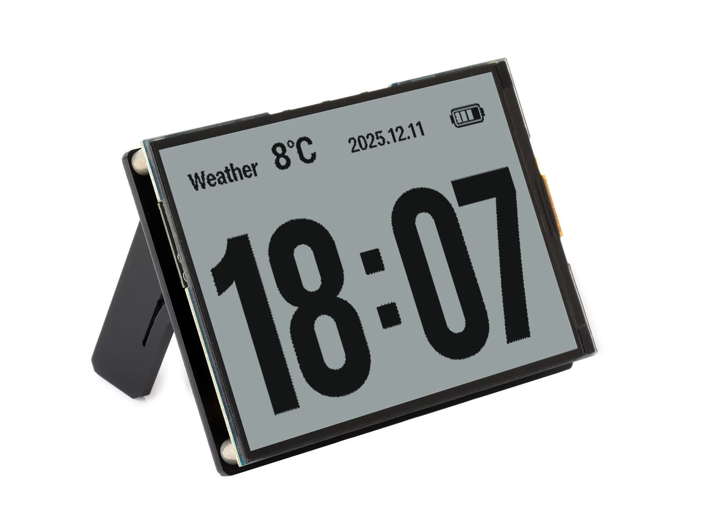

  <h1>ESP32-S3-RLCD-4.2</h1>
  
<strong>ESP32-S3 4.2 英寸 300 × 400 反射式 LCD AIoT 开发板</strong>

  
<a href="README.md">English</a> | <strong>简体中文</strong>

  

    
    
    
  

  

    <a href="https://www.waveshare.com/esp32-s3-rlcd-4.2.htm">🌐 产品</a> &middot;
    <a href="https://github.com/waveshareteam/ESP32-S3-RLCD-4.2/releases/latest">📦 固件</a> &middot;
    <a href="examples/esp-idf/">🧩 ESP-IDF</a> &middot;
    <a href="examples/arduino/examples/">🔧 Arduino</a> &middot;
    <a href="https://docs.waveshare.net/ESP32-S3-RLCD-4.2/">📚 文档</a>
  

  

---

## ✨ 概述

ESP32-S3-RLCD-4.2 是一块 AIoT 开发板，采用 ESP32-S3-WROOM-1-N16R8 模组（16 MB Flash、8 MB PSRAM），
配备无需背光的 4.2 英寸反射式 LCD。本仓库提供它的 ESP-IDF 和 Arduino 示例，以及可直接烧录的示例固件。

| 功能 | 器件或接口 |
| --- | --- |
| MCU | ESP32-S3-WROOM-1-N16R8，2.4 GHz Wi-Fi 和蓝牙 5 LE |
| 存储器 | 16 MB Flash，8 MB PSRAM |
| 显示 | 4.2 英寸 300 × 400 反射式 LCD，ST7305 控制器 |
| 音频 | ES8311 音频编解码器；ES7210 ADC 双麦克风阵列 |
| RTC | PCF85063 |
| 传感器 | SHTC3 温湿度传感器 |
| 存储 | TF 卡槽 |
| 供电 | USB Type-C 和 18650 电池座 |

## 📦 快速开始

体验示例最快的方法是使用[最新版本](https://github.com/waveshareteam/ESP32-S3-RLCD-4.2/releases/latest)中打包好的可烧录固件。

1. 下载所需示例和框架版本对应的 `*-combined.zip`。
2. 解压后通过 `python -m pip install esptool` 安装 esptool。
3. 通过 USB 连接开发板。
4. Windows 运行 `flash_combined.bat COMx`，Linux 运行 `./flash_combined.sh /dev/ttyACM0`。
5. 如果开发板未自动重启，请手动复位。

出厂固件（恢复开箱演示）：在 [`firmware`](firmware/README_ZH.md) 目录下载文件名带 `FactoryOnly` 的文件。

## 🧪 示例

### ESP-IDF

| 示例 | 主要功能 |
| --- | --- |
| [01_WIFI_AP](examples/esp-idf/01_WIFI_AP/README_ZH.md) | Wi-Fi 热点 |
| [02_WIFI_STA](examples/esp-idf/02_WIFI_STA/README_ZH.md) | Wi-Fi 连接 |
| [03_ADC_Test](examples/esp-idf/03_ADC_Test/README_ZH.md) | 电池电压 |
| [04_I2C_PCF85063](examples/esp-idf/04_I2C_PCF85063/README_ZH.md) | RTC 时钟 |
| [05_I2C_SHTC3](examples/esp-idf/05_I2C_SHTC3/README_ZH.md) | 温湿度 |
| [06_SD_Card](examples/esp-idf/06_SD_Card/README_ZH.md) | TF 卡 |
| [07_Audio_Test](examples/esp-idf/07_Audio_Test/README_ZH.md) | 音频 |
| [08_LVGL_V8_Test](examples/esp-idf/08_LVGL_V8_Test/README_ZH.md) | LVGL 8 |
| [09_LVGL_V9_Test](examples/esp-idf/09_LVGL_V9_Test/README_ZH.md) | LVGL 9 |
| [10_FactoryProgram](examples/esp-idf/10_FactoryProgram/README_ZH.md) | 出厂测试程序 |
| [11_U8G2_Test](examples/esp-idf/11_U8G2_Test/README_ZH.md) | U8g2 |

### Arduino

| 示例 | 主要功能 |
| --- | --- |
| [01_WIFI_AP](examples/arduino/examples/01_WIFI_AP/README_ZH.md) | Wi-Fi 热点 |
| [02_WIFI_STA](examples/arduino/examples/02_WIFI_STA/README_ZH.md) | Wi-Fi 连接 |
| [03_ADC_Test](examples/arduino/examples/03_ADC_Test/README_ZH.md) | 电池电压 |
| [04_I2C_PCF85063](examples/arduino/examples/04_I2C_PCF85063/README_ZH.md) | RTC 时钟 |
| [05_I2C_SHTC3](examples/arduino/examples/05_I2C_SHTC3/README_ZH.md) | 温湿度 |
| [06_SD_Card](examples/arduino/examples/06_SD_Card/README_ZH.md) | TF 卡 |
| [07_Audio_Test](examples/arduino/examples/07_Audio_Test/README_ZH.md) | 音频 |
| [09_LVGL_V9_Test](examples/arduino/examples/09_LVGL_V9_Test/README_ZH.md) | LVGL 9 |
| [10_U8G2_Test](examples/arduino/examples/10_U8G2_Test/README_ZH.md) | U8g2 |

草图使用的库随仓库提供，位于 [`examples/arduino/libraries`](examples/arduino/libraries/)。
ESPHome 配置位于 [`examples/esphome`](examples/esphome/README_ZH.md)，小智 AI 固件源码位于 [`examples/xiaozhi`](examples/xiaozhi/)。

## 🛠️ 开发环境

| 开发框架 | 版本 | 示例数 |
| --- | --- | ---: |
| ESP-IDF | `v5.5.5` | 11 |
| Arduino-ESP32 | `3.3.12` | 9 |

## 📚 资料

- [产品页面](https://www.waveshare.com/esp32-s3-rlcd-4.2.htm)
- [Wiki](https://docs.waveshare.net/ESP32-S3-RLCD-4.2/)（原理图、引脚图和教程）

## 🤝 支持

- 示例或仓库问题：[提交 issue](https://gitee.com/waveshare/ESP32-S3-RLCD-4.2/issues)。
- 产品使用、硬件或订单问题：[微雪技术支持](https://docs.waveshare.net/ESP32-S3-RLCD-4.2/Technical-Support/)。

## 📄 许可证

Apache License 2.0，详见 [LICENSE](LICENSE)。
